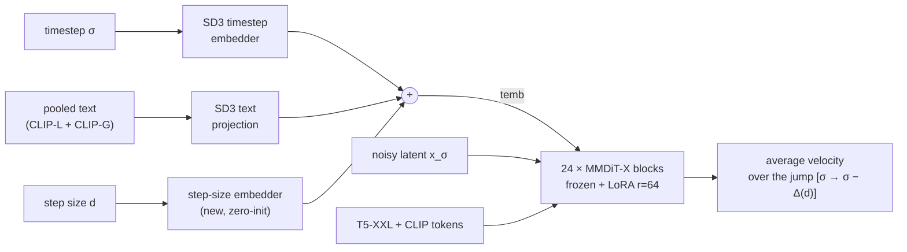
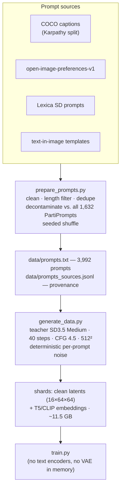

<div align="center">

# Shortcut Distillation of Stable Diffusion 3.5 Medium

**4-step text-to-image generation with SD3.5 Medium via shortcut-model self-consistency, trained as a LoRA adapter with an explicit step-size embedding**

[](https://www.python.org/)
[](https://pytorch.org/)
[](https://github.com/huggingface/diffusers)
[](https://huggingface.co/stabilityai/stable-diffusion-3.5-medium)
[](https://arxiv.org/abs/2410.12557)
[](LICENSE)

[Task](#1-task) · [Method](#2-method) · [Data](#3-data) · [Training](#4-training) · [Evaluation](#5-evaluation-protocol) · [Results](#6-results) · [Reproduce](#7-reproducing) · [Design decisions](#9-design-decisions-and-deviations) · [Citation](#13-citation)

</div>

---

## TL;DR

- **What.** A *shortcut model* (Frans et al., ICLR 2025) distilled from **Stable Diffusion 3.5 Medium**: the network is conditioned on the desired **step size `d`** and learns to jump along the probability-flow ODE, so one model samples in **1 / 2 / 4 / 8 steps**.
- **How.** Frozen 2.24B MMDiT-X + **LoRA r=64 (130M params, ~6%)** + a new **zero-initialised step-size embedder (2.8M)**. Loss = flow matching at `d=0` + self-consistency *"one 2d-jump = two d-jumps"*; classifier-free guidance (CFG 4.5) is distilled into every `d>0`, so the student needs **one forward pass per step: 4 NFE vs. 80 NFE** for the teacher (40 steps × CFG).
- **Data.** **3,992 images generated by the teacher itself** (40 steps, CFG 4.5, 512²) from a 4-source prompt corpus that is **decontaminated against all 1,632 PartiPrompts**.
- **Evaluation.** First 100 PartiPrompts + the 4 prompts from the task statement; teacher (40 steps) vs. naive teacher (4 steps) vs. student (1/2/4/8 steps) under identical noise; CLIP score, PickScore, CLIP similarity to the teacher, latency.

> [!NOTE]
> **Status.** Code, data pipeline and evaluation are complete and tested (CPU smoke tests, a toy correctness experiment, and an on-GPU benchmark on 1×H800). The full training run is in progress; the [Results](#6-results) tables are filled in when it finishes.

---

## Contents

1. [Task](#1-task)
2. [Method](#2-method)
3. [Data](#3-data)
4. [Training](#4-training)
5. [Evaluation protocol](#5-evaluation-protocol)
6. [Results](#6-results)
7. [Reproducing](#7-reproducing)
8. [Repository structure](#8-repository-structure)
9. [Design decisions and deviations](#9-design-decisions-and-deviations)
10. [Verification](#10-verification)
11. [Compute and cost](#11-compute-and-cost)
12. [Limitations and future work](#12-limitations-and-future-work)
13. [Citation](#13-citation)
14. [Acknowledgements and licenses](#14-acknowledgements-and-licenses)

---

## 1. Task

The task statement (a one-page PDF, not redistributed in this repository) reads, verbatim:

> **Shortcut Distillation**
>
> Реализовать Shortcut дистилляцию на моделе Stable Diffusion 3.5 Medium. Для того, чтоб сделать обучение быстрее рекомендуем обучить LoRA адаптер.
> Данные нужно сгенерировать (достаточно 3-5k картинок). Статья: https://arxiv.org/pdf/2410.12557
>
> Бенчмарк: PartiPrompts (не обязательно генерировать все 1600 примеров, достаточно первых 100)
> Ожидаемый результат - подобные генерации за 4 шага.
>
> *"A realistic cheetah holding a sign that says: 'Fast as hell!'"* · *"An astronaut riding a horse in a photorealistic style"* · *"A dog wearing a baseball cap backwards and writing BONEZ on a chalkboard"* · *"A castle made of cardboard."*

**Translation.** Implement shortcut distillation of Stable Diffusion 3.5 Medium; training a LoRA adapter is recommended to make training faster. The data must be generated (3–5k images are enough). Paper: arXiv:2410.12557. Benchmark: PartiPrompts (the first 100 of ~1600 prompts are enough). Expected result: generations like the four examples above, **in 4 steps**.

### Requirement → implementation

| # | Requirement (task statement) | Implementation | Where |
|---|---|---|---|
| R1 | Shortcut distillation, arXiv:2410.12557 | Shortcut objective: flow matching at `d=0` + self-consistency over binary step sizes; explicit conditioning on `d` | [`shortcut_sd35/shortcut.py`](shortcut_sd35/shortcut.py), [`scripts/train.py`](scripts/train.py) |
| R2 | Stable Diffusion 3.5 Medium | `stabilityai/stable-diffusion-3.5-medium`, base weights frozen | — |
| R3 | LoRA adapter | LoRA r=64 on all 24 MMDiT-X blocks (130.4M params) + step-size embedder (2.8M) | [`shortcut.py`](shortcut_sd35/shortcut.py) |
| R4 | Generated data, 3–5k images | **3,992** teacher generations (latents + text embeddings) | [`scripts/generate_data.py`](scripts/generate_data.py) |
| R5 | PartiPrompts, first 100 | First 100 rows of the official PartiPrompts set (HF mirror `nateraw/parti-prompts`, 1,632 prompts) | [`scripts/evaluate.py`](scripts/evaluate.py) |
| R6 | Results like the examples, in 4 steps | Student sampled with 4 steps (4 NFE, no CFG); dedicated grid on the 4 task prompts | [`scripts/evaluate.py`](scripts/evaluate.py) |

---

## 2. Method

### 2.1 Flow matching in the SD3 convention

SD3 is a rectified-flow model. With data $x_0$, noise $\varepsilon \sim \mathcal N(0, I)$ and noise level $\sigma \in [0, 1]$ ($\sigma = 1$ is pure noise):

$$
x_\sigma = (1-\sigma)\,x_0 + \sigma\,\varepsilon, \qquad v_\theta(x_\sigma, \sigma) \approx \varepsilon - x_0, \qquad x_{\sigma'} = x_\sigma + (\sigma' - \sigma)\, v_\theta(x_\sigma, \sigma).
$$

The shortcut paper uses the opposite time direction ($t = 0$ is noise); all formulas below are rewritten in the SD3 convention.

### 2.2 Shortcut models

A shortcut model $s_\theta(x_\sigma, \sigma, d)$ predicts the **average velocity over a jump of size $d$** rather than the instantaneous velocity. At $d = 0$ it is the ordinary flow model. Larger jumps are learned by **self-consistency**: one jump of size $2d$ must equal two consecutive jumps of size $d$. Each training batch mixes two losses (paper, Eq. 5 / Alg. 1):

$$
\mathcal L(\theta) =
\underbrace{\bigl\lVert s_\theta(x_\sigma, \sigma, 0) - (\varepsilon - x_0) \bigr\rVert^2}_{\text{flow matching, fraction } 1-k}
\;+\;
\underbrace{\bigl\lVert s_\theta(x_\sigma, \sigma, 2d) - \operatorname{sg}\bigl[s_{\text{target}}\bigr] \bigr\rVert^2}_{\text{self-consistency, fraction } k}
$$

with the bootstrap target built from two half-jumps of the **EMA** model:

$$
x' = x_\sigma - \Delta_1\, s_{\bar\theta}(x_\sigma, \sigma_0, d), \qquad
s_{\text{target}} = \frac{\Delta_1\, s_{\bar\theta}(x_\sigma, \sigma_0, d) + \Delta_2\, s_{\bar\theta}(x', \sigma_1, d)}{\Delta_1 + \Delta_2},
\qquad \Delta_1 = \sigma_0 - \sigma_1,\; \Delta_2 = \sigma_1 - \sigma_2 .
$$

As in the paper, step sizes are powers of two on a grid of $M$ steps, start times are multiples of the step size ("discrete time sampling"), and the second half-jump is queried at the **next** time $\sigma_1$ (Eq. 5 of the paper writes $t$; Algorithm 1 and the official code use $t + d$).

### 2.3 Adapting shortcut models to a pretrained SD3.5

| Question | Solution | Precedent |
|---|---|---|
| Non-uniform time grid (SD3 uses `shift = 3`) | `d` lives in uniform time $u$, with $\sigma(u) = 3u / (1 + 2u)$. Half-jumps have unequal $\sigma$-lengths, so the target is the **$\Delta\sigma$-weighted** average above. On a uniform grid it reduces exactly to the paper's $(s_1 + s_2)/2$ | MAGI-1, SCFM |
| How to feed `d` into a pretrained model | New **step-size embedder** (sinusoidal → MLP) whose **last layer is zero-initialised**; its output is added to SD3's `temb` (timestep + pooled text), which drives the adaLN modulation of every block. At initialisation, student ≡ teacher | SAM 3D (App. C.4); DiT shortcut models |
| What is trained | LoRA (r=64, α=64) on image/text attention (incl. the extra `attn2` self-attention of the first 13 MMDiT-X blocks), MLPs and adaLN projections, plus the step-size embedder; everything else frozen | SD3 paper (DPO-LoRA), SCFM |
| Classifier-free guidance | CFG 4.5 is applied **only at the base level** (half-jumps at $d=0$); through the recursion it is baked into all $d > 0$, so few-step sampling runs **without CFG** (1 NFE/step) | Official code, MAGI-1, SAM 3D |
| Base case of the recursion | Half-jumps at $d = 0$ are evaluated by the **frozen teacher** (same weights, adapter disabled); `--base_velocity ema` gives the paper's pure self-bootstrapped variant | [§9](#9-design-decisions-and-deviations) |



### 2.4 Sampling

For $n$ steps the sampler uses the shifted grid $\sigma_i = \sigma(1 - i/n)$ and $d = 1/n$:
$x \leftarrow x + (\sigma_{i+1} - \sigma_i)\, s_\theta(x, \sigma_i, d)$ — **one forward pass per step, no CFG**.
For $n \ge M$ the same model runs as the original flow model ($d = 0$, CFG 4.5).

---

## 3. Data

### 3.1 Pipeline



### 3.2 Prompt corpus

The task statement fixes the *images* (generated, 3–5k) but not the *prompts*. The corpus below is built to (i) resemble the benchmark's style without overlapping it, (ii) cover the visual styles that SD3.5 users actually request, and (iii) explicitly cover **text rendering**, which two of the four task examples require and which is the first capability to degrade in few-step students.

| Source | HF id | Prompts | Share | Words (median) | License | Why it is included |
|---|---|---:|---:|---:|---|---|
| COCO captions, Karpathy split | [`yerevann/coco-karpathy`](https://huggingface.co/datasets/yerevann/coco-karpathy) | 1,598 | 40.0% | 10 | CC BY 4.0 (COCO annotations) | Short compositional scenes (objects, counts, relations) — closest in style to PartiPrompts; one random caption per image |
| open-image-preferences-v1 | [`data-is-better-together/open-image-preferences-v1-binarized`](https://huggingface.co/datasets/data-is-better-together/open-image-preferences-v1-binarized) | 1,400 | 35.1% | 26 | Apache-2.0 | Community-curated modern T2I prompts across many categories (photography, anime, digital art, …); only the `prompt` column is read |
| Lexica Stable Diffusion prompts | [`Gustavosta/Stable-Diffusion-Prompts`](https://huggingface.co/datasets/Gustavosta/Stable-Diffusion-Prompts) | 599 | 15.0% | 35 | unknown (per dataset card) | Breadth of artistic styles and artist references typical of SD prompting |
| Text-in-image templates | generated in [`prepare_prompts.py`](scripts/prepare_prompts.py) | 395 | 9.9% | 11 | — | Typography: *"X holding a sign that says '…'"*, *"… writing … on a chalkboard"*, mugs, neon signs, book covers |
| **Total** | | **3,992** | 100% | 13.5 | | |

**Construction rules** ([`scripts/prepare_prompts.py`](scripts/prepare_prompts.py), seed 0, fully reproducible):

1. **Decontamination.** Every candidate is normalised (lower-case, alphanumerics only) and dropped if it matches **any of the 1,632 PartiPrompts** — not just the 100 used for evaluation.
2. **Length.** 3–60 words (T5 sees up to 256 tokens; CLIP truncates at 77).
3. **Deduplication** after normalisation; templates are re-drawn until the target size is reached.
4. **Provenance.** [`data/prompts_sources.jsonl`](data/prompts_sources.jsonl) records the source of every prompt.
5. **No content filtering by default.** An optional `--filter` flag drops prompts that match a blocklist (sexual content, gore, weapons, drugs, extremism, politics, frequent celebrity names).

**Verified properties of the final corpus:** 0 PartiPrompts (of 1,632); 0 of the 4 task prompts; 0 near-duplicates of them (e.g. no "astronaut + horse" or "cardboard + castle" prompts). Two of the four task prompts are themselves PartiPrompts, so benchmark decontamination also covers them.

### 3.3 Teacher generation

| Setting | Value | Rationale |
|---|---|---|
| Teacher | SD3.5 Medium, bf16 | task requirement |
| Sampler | `FlowMatchEulerDiscreteScheduler`, shift 3.0, **40 steps** | model-card recommendation |
| Guidance | CFG **4.5**, unconditional branch = empty prompt `""` | model-card recommendation; same null embedding is used for CFG distillation |
| Resolution | **512 × 512** | compute budget, see [§9](#9-design-decisions-and-deviations) and [§11](#11-compute-and-cost) |
| Text encoders | CLIP-L + OpenCLIP bigG + T5-XXL, `max_sequence_length = 256` | SD3.5 pipeline default |
| Noise | per-prompt deterministic: `seed = 1_000_003 · s + i` | independent of batch size / number of workers |
| Stored per sample | clean **latent in model space** (after the pipeline's own normalisation), T5+CLIP token embeddings, pooled embedding — all fp16 | training needs neither the VAE nor the 4.7B-parameter T5 |
| Storage | 8 safetensors shards (512 samples each), ~11.5 GB; written atomically (resumable) | — |
| Throughput (measured) | **0.82 img/s** on 1×H800 PCIe (batch 16) → ~81 min for 3,992 images | [§11](#11-compute-and-cost) |

<p align="center">
  
  <br><em>Samples of the generated training data (teacher, 40 steps, CFG 4.5, 512²) for COCO/Lexica prompts:
  "a portrait of a evil dog dancing techno-style, cyberpunk concept art…", "A white sink sitting next to a toilet.",
  "A brown bear sitting against a tree with some leaves around him."</em>
</p>

Why teacher generations and not real images: the task requires generated data, and a distilled student must reproduce the **teacher's** distribution. Training on real photographs would instead fine-tune towards a different distribution.

---

## 4. Training

| Hyperparameter | Value | Source / note |
|---|---|---|
| Base grid $M$ (`--base_steps`) | 32 → student step sizes $d \in \{1/16, 1/8, \mathbf{1/4}, 1/2, 1\}$ | paper uses 128; see [§9](#9-design-decisions-and-deviations) |
| Self-consistency fraction $k$ | 0.25 | paper; SAM 3D |
| Level sampling | round-robin over levels, uniform start times on the level's grid | official code |
| EMA (bootstrap targets) | 0.999 | paper |
| Optimizer | AdamW, lr 1e-4 (100 warm-up steps), weight decay 0.1, grad-clip 1.0 | paper (weight decay "crucial for stability") |
| Prompt dropout in the FM branch | 0.1 (replaced by empty-prompt embedding) | keeps the unconditional branch alive |
| Batch / steps | 8 / 6,000 (~12 epochs over 3,992 samples) | — |
| Precision | bf16 autocast; LoRA + embedder master weights, Adam and EMA in fp32; TF32 enabled | — |
| Trainable parameters | LoRA 130.4M + step-size embedder 2.8M (base 2.24B frozen) | counted on the real config |
| Throughput (measured) | **0.72 s/step**, peak memory **37.1 GB** (no gradient checkpointing) on 1×H800 PCIe | [§11](#11-compute-and-cost) |

**Logged metrics** (TensorBoard via [`scripts/tb_sidecar.py`](scripts/tb_sidecar.py)): `loss/total`, `loss/flow_matching_d0`, `self_consistency/{01,02,04,08,16}_steps`, `train/grad_norm`, `train/lr`, `perf/*`, validation grids every 250 steps (rows = 1/2/4/8 steps, columns = the 4 task prompts), teacher-generation progress, final evaluation tables.

---

## 5. Evaluation protocol

**Prompts.** The first 100 PartiPrompts (as required) plus the 4 prompts of the task statement (qualitative grid).

> [!IMPORTANT]
> The first 100 PartiPrompts are all in the *Basic* challenge, 45 of them in the *Abstract* category, with a median length of **2 words** (*"bond"*, *"element"*, *"insight"*, *"an owl"*, …). They are much easier than the task's showcase prompts, which require multi-object scenes and text rendering. We therefore report the 4 task prompts separately.

**Methods** — all with the **same initial noise per prompt**, so images are directly comparable:

| Method | Steps | CFG | NFE / image |
|---|---:|---|---:|
| Teacher (reference) | 40 | 4.5 | 80 |
| Naive teacher (the baseline to beat) | 4 | 4.5 | 8 |
| **Shortcut student** | 1 / 2 / **4** / 8 | distilled | 1 / 2 / **4** / 8 |

**Metrics.**

| Metric | Measures | Model |
|---|---|---|
| CLIP score ↑ | prompt alignment, $100 \cdot \max(\cos(\text{img}, \text{text}), 0)$ | `openai/clip-vit-large-patch14` |
| PickScore ↑ | human-preference proxy | `yuvalkirstain/PickScore_v1` |
| CLIP-I to teacher ↑ | fidelity to the 40-step teacher image from the same noise | CLIP-L image embeddings |
| Latency ↓ | transformer time per image (bf16, 1×H800 PCIe) | — |

---

## 6. Results

> [!NOTE]
> ⏳ Filled in when the full training run finishes. Placeholders show the exact layout of the final tables.

### 6.1 Main results — PartiPrompts (first 100), 512²

| Method | Steps | NFE | CLIP score ↑ | PickScore ↑ | CLIP-I to teacher ↑ | Latency, s/img ↓ |
|---|---:|---:|---:|---:|---:|---:|
| Teacher, CFG 4.5 | 40 | 80 | ⏳ | ⏳ | 1.000 | ⏳ |
| Naive teacher, CFG 4.5 | 4 | 8 | ⏳ | ⏳ | ⏳ | ⏳ |
| Shortcut student | 1 | 1 | ⏳ | ⏳ | ⏳ | ⏳ |
| Shortcut student | 2 | 2 | ⏳ | ⏳ | ⏳ | ⏳ |
| **Shortcut student** | **4** | **4** | ⏳ | ⏳ | ⏳ | ⏳ |
| Shortcut student | 8 | 8 | ⏳ | ⏳ | ⏳ | ⏳ |

### 6.2 Task prompts (qualitative)

⏳ *Grid: rows = the 4 prompts of the task statement; columns = teacher 40 steps · naive 4 steps · student 1/2/4/8 steps.*

### 6.3 Baseline: the teacher with few steps

<p align="center">
  
  <br><em>Starting point of training (step 0 = the teacher, since the step-size embedder is zero-initialised).
  Rows: 1, 2, 4, 8 Euler steps without CFG; columns: the four task prompts.
  One step collapses to the conditional mean (cf. Fig. 2 of the paper); 4–8 steps are hazy and the text is unreadable.</em>
</p>

### 6.4 Training dynamics

⏳ *TensorBoard curves: per-level self-consistency losses, flow-matching loss, gradient norm; validation grids over training.*

### 6.5 Sanity check: shortcut learning on a toy problem

[`tests/toy_bimodal.py`](tests/toy_bimodal.py) pretrains a tiny SD3-architecture flow model on bimodal data (every latent is all +1 or all −1) and then distils it with the real `train.py`. Comparison with the teacher's 32-step ODE solution from the same noise:

| | 1 step: on-mode / MSE | 2 steps: on-mode / MSE | 4 steps: on-mode / MSE |
|---|---|---|---|
| Teacher, naive Euler | 34% / 0.556 | 92% / 0.087 | 100% / 0.031 |
| **Shortcut student** | **86% / 0.246** | **98%** / 0.128 | 100% / 0.079 |

Naive one-step Euler collapses to the mean of the two modes; the shortcut student does not. This verifies the objective, not image quality on SD3.5.

---

## 7. Reproducing

### 7.1 Software stack

| Component | Version | Note |
|---|---|---|
| Python | 3.12 | numpy 2.5 requires ≥ 3.12 |
| PyTorch | **2.15.0 + cu132** | wheel ships CUDA 13.2.2, cuDNN 9.26, NCCL; needs a driver with CUDA ≥ 13.2 |
| PyTorch (fallback) | 2.14.1 + cu126 | for CUDA 12.x drivers (`TORCH_CU=cu126`); also passes all tests |
| CUDA toolkit / nvcc | **not required** | no custom kernels; attention via PyTorch SDPA (FlashAttention-2 / cuDNN on Hopper) |
| diffusers · transformers · peft · accelerate | 0.43.0 · 5.23.0 · 0.22.0 · 1.16.0 | exact pins in [`requirements.txt`](requirements.txt) |

### 7.2 Quick start (any Linux box with one ≥ 24 GB GPU)

```bash
pip install torch==2.15.0 --index-url https://download.pytorch.org/whl/cu132   # or 2.14.1/cu126
pip install -r requirements.txt
hf auth login                      # account that accepted the SD3.5 Medium license
bash run_all.sh                    # data → training → evaluation; RES=1024 for 1024²
```

`run_all.sh` uses all visible GPUs (data generation is sharded across GPUs, training runs with DDP) and picks per-GPU defaults ([`scripts/gpu_defaults.sh`](scripts/gpu_defaults.sh)): on ≥ 60 GB GPUs gradient checkpointing is off and the generation batch is 16.

### 7.3 Remote GPU box, step by step

```bash
export ROOT=/path/to/big/disk         # venv, HF cache, data, runs (≥ 60 GB free)
bash setup_env.sh install             # (no GPU needed) Python 3.12 venv + torch build matched to the host driver
source $ROOT/shortcut_env.sh
hf auth login                         # or put the token into $HF_HOME/token
bash setup_env.sh download            # (no GPU needed) SD3.5 Medium (diffusers folders only), metric models, PartiPrompts
bash setup_env.sh check               # driver / CUDA / sm_90 / bf16 TFLOPS / attention kernels
bash setup_env.sh bench               # ~5 min: 64 teacher images + 30 train steps → measured ETA and cost
mkdir -p logs && nohup bash run_all.sh > logs/run_all.log 2>&1 &
```

Optional: `NETWORK_SETUP=/path/to/proxy.sh` is sourced before downloads; `HF_ENDPOINT` is honoured as usual.

### 7.4 Using a trained student

```python
import torch
from diffusers import StableDiffusion3Pipeline
from shortcut_sd35.shortcut import load_student, shortcut_sample

pipe = StableDiffusion3Pipeline.from_pretrained(
    "stabilityai/stable-diffusion-3.5-medium", torch_dtype=torch.bfloat16).to("cuda")
student, cfg = load_student("runs/shortcut_512/final/student_ema", pipe.transformer)

pe, _, pp, _ = pipe.encode_prompt("A castle made of cardboard.", None, None,
                                  do_classifier_free_guidance=False)
noise = torch.randn(1, 16, 64, 64, device="cuda")
with torch.no_grad(), torch.autocast("cuda", dtype=torch.bfloat16):
    latents = shortcut_sample(student, noise, pe, pp, num_steps=4, cfg=cfg)   # 4 NFE, no CFG
    latents = latents / pipe.vae.config.scaling_factor + pipe.vae.config.shift_factor
    image = pipe.vae.decode(latents.to(pipe.vae.dtype)).sample
pipe.image_processor.postprocess(image)[0].save("castle_4steps.png")
```

---

## 8. Repository structure

```
shortcut_sd35/
  shortcut.py            step-size embedder, ShortcutSD3 wrapper, time grid, self-consistency targets,
                         sampler, EMA, LoRA save/load
  data.py                lazy shard dataset (safetensors slicing), task showcase prompts
scripts/
  prepare_prompts.py     prompt corpus (4 sources, decontamination, provenance)
  generate_data.py       teacher generation → latents + text embeddings (GPU-sharded, resumable)
  train.py               shortcut distillation (accelerate / DDP)
  evaluate.py            PartiPrompts evaluation: metrics + grids
  tb_sidecar.py          mirrors run logs into TensorBoard
  check_env.py           GPU / CUDA / torch sanity check
  bench_report.py        full-run ETA and cost from a 5-minute benchmark
  gpu_defaults.sh        per-GPU defaults (batch, gradient checkpointing)
data/
  prompts.txt            the 3,992 training prompts
  prompts_sources.jsonl  provenance of every prompt
tests/
  test_smoke.py          CPU tests on a tiny random SD3 (MMDiT-X with dual attention)
  toy_bimodal.py         toy experiment: does the objective learn shortcuts?
setup_env.sh             install / download / check / bench on a GPU box
run_all.sh               full pipeline
```

---

## 9. Design decisions and deviations

Choices that the task statement does not fix, stated explicitly:

| Decision | Rationale | Alternative (one flag away) |
|---|---|---|
| **Resolution 512²** | The task does not specify a resolution (its examples are ≈ 830×480). 512² is the cheapest point inside SD3.5's supported range (0.25–2 MP) and fits the compute budget; SCFM reports that velocity-space shortcut LoRAs trained at 512 transfer to 1024 | `RES=1024` (×4.6 cost) or 832×480 (×1.5); evaluation alone can run at any resolution |
| **Start from the pretrained model** instead of training from scratch | The task asks for *distillation* of SD3.5 with a LoRA; SAM 3D and MAGI-1 fine-tune pretrained flow models with the shortcut objective in the same way | — |
| **Finest grid 1/32** (paper: 1/128) | SD3.5 already samples well in ~32 steps; fewer levels mean less bootstrap error accumulation | `--base_steps 64/128` |
| **Base case from the frozen teacher** (paper: the model's own $d=0$ head) | In distillation the teacher is the ground-truth ODE. It also avoids drift of the student's $d=0$ head and double guidance, because the flow-matching branch is trained on CFG-generated images. In the toy experiment it halved the 4-step error w.r.t. the teacher (0.079 vs. 0.162) | `--base_velocity ema` (exactly the paper) |
| **Prompt corpus** | Not specified by the task; see [§3.2](#32-prompt-corpus) | `prepare_prompts.py --frac_* / --filter` |

---

## 10. Verification

| Check | What it guarantees |
|---|---|
| `python tests/test_smoke.py` (CPU, tiny random SD3 with dual attention) | zero-init ⇒ output independent of `d`, `teacher_mode` ≡ base model; LoRA reaches `attn2` and adaLN; the 4-step grid is a subset of the 32-step grid; the target equals an explicit two-step Euler (and the paper's average on a uniform grid); CFG; EMA weight swapping; end-to-end `train.py` in fp32 and bf16 with resume; `load_student` + sampling; `evaluate.teacher_sample` ≡ the diffusers pipeline loop |
| `torchrun --nproc_per_node 2` (CPU / gloo) | DDP + LoRA + gradient checkpointing; logging and saving only on rank 0 |
| `python tests/toy_bimodal.py` | the objective actually learns shortcuts ([§6.5](#65-sanity-check-shortcut-learning-on-a-toy-problem)) |
| `setup_env.sh check` / `bench` on 1×H800 PCIe | stack (torch 2.15 + CUDA 13.2, sm_90), 508 TFLOPS bf16 matmul, flash/cuDNN SDPA; real throughput and memory |
| Both torch 2.15.0 and 2.14.1 | all smoke tests pass on the primary and the fallback stack |

---

## 11. Compute and cost

Exact transformer FLOPs per forward pass (`torch.utils.flop_counter`, real SD3.5 Medium config, 333 text tokens):

| Resolution | Megapixels | Image tokens | TFLOP / forward | Relative |
|---|---:|---:|---:|---:|
| **512 × 512** | 0.26 | 1,024 | **2.44** | 1.00× |
| 832 × 480 | 0.40 | 1,560 | 3.67 | 1.50× |
| 768 × 768 | 0.59 | 2,304 | 5.59 | 2.29× |
| 1024 × 1024 | 1.05 | 4,096 | 11.25 | 4.61× |

Measured on **1× NVIDIA H800 PCIe 80 GB** (508 TFLOPS bf16 matmul):

| Stage | Measured | Full run |
|---|---|---|
| Teacher data (3,992 images) | 0.82 img/s | ~81 min |
| Training (6,000 steps) | 0.72 s/step, 37.1 GB peak | ~72 min |
| Evaluation (104 prompts × 6 configurations) | — | ~8 min |
| **Total** | | **~2.7 GPU-hours ≈ $4** (at ≈ $1.50 per GPU-hour) |

---

## 12. Limitations and future work

- **Benchmark difficulty.** The required first-100 PartiPrompts slice is dominated by one- and two-word prompts; a stratified Parti sample (all categories and challenges) would be more informative.
- **Resolution.** Trained at 512²; transfer to 832×480 (the task's example format) and 1024² should be measured, and training at the target resolution may be needed.
- **Training length.** 6,000 steps is a budget choice; the bootstrap fraction (0.25 → 0.5) and the EMA schedule (SCFM's fast/slow EMA) are natural knobs.
- **Text rendering** is the hardest capability for few-step students; the corpus covers it explicitly, but it should be evaluated with an OCR metric.
- **No adversarial loss.** Many few-step distillations (ADD, LADD) add a GAN term; this repository deliberately implements the pure shortcut objective required by the task.

---

## 13. Citation

```bibtex
@inproceedings{frans2025shortcut,
  title     = {One Step Diffusion via Shortcut Models},
  author    = {Frans, Kevin and Hafner, Danijar and Levine, Sergey and Abbeel, Pieter},
  booktitle = {International Conference on Learning Representations (ICLR)},
  year      = {2025}
}

@inproceedings{esser2024sd3,
  title     = {Scaling Rectified Flow Transformers for High-Resolution Image Synthesis},
  author    = {Esser, Patrick and Kulal, Sumith and Blattmann, Andreas and others},
  booktitle = {International Conference on Machine Learning (ICML)},
  year      = {2024}
}

@misc{suchotin2026shortcutsd35,
  title  = {Shortcut Distillation of Stable Diffusion 3.5 Medium},
  author = {Suchotin},
  year   = {2026},
  url    = {https://github.com/Suchotin/shortcut_distillation_sd3.5}
}
```

Related work this implementation draws on:
[SAM 3D](https://arxiv.org/abs/2511.16624) (shortcut fine-tuning of a pretrained flow model, zero-init step-size embedder) ·
[MAGI-1](https://arxiv.org/abs/2505.13211) (shortcut distillation with CFG distillation, step sizes on a shifted grid) ·
[SCFM](https://arxiv.org/abs/2510.17858) (shortcutting pretrained Flux / SD3.5 with LoRA) ·
[PartiPrompts](https://arxiv.org/abs/2206.10789) ·
[LoRA](https://arxiv.org/abs/2106.09685) ·
[PickScore](https://arxiv.org/abs/2305.01569) ·
[CLIP](https://arxiv.org/abs/2103.00020).

## 14. Acknowledgements and licenses

- **Code:** MIT ([LICENSE](LICENSE)).
- **Teacher model and derived weights:** Stable Diffusion 3.5 Medium is released under the [Stability AI Community License](https://huggingface.co/stabilityai/stable-diffusion-3.5-medium); LoRA adapters trained with this code are derivatives and inherit its terms.
- **Data:** COCO captions (CC BY 4.0), open-image-preferences-v1 (Apache-2.0), Lexica SD prompts (license unknown per the dataset card), PartiPrompts (Apache-2.0). Training images are generated by the teacher and are not redistributed.
- Thanks to the authors of shortcut models for the clear paper and [official implementation](https://github.com/kvfrans/shortcut-models).
