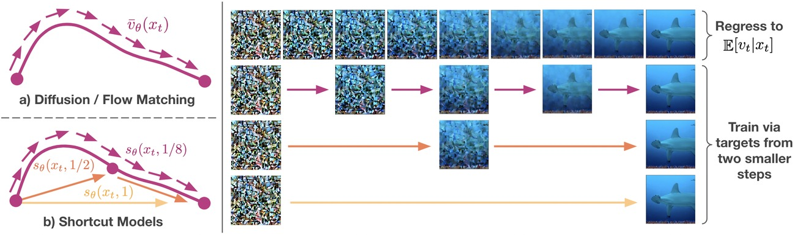
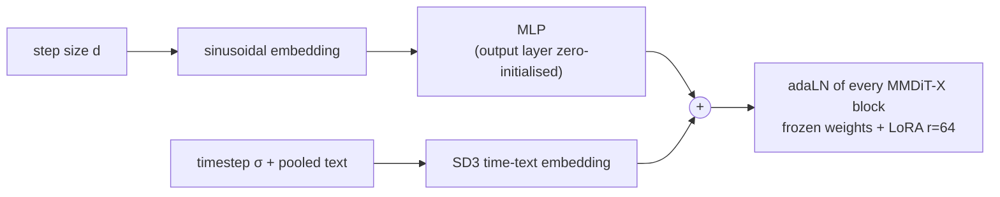
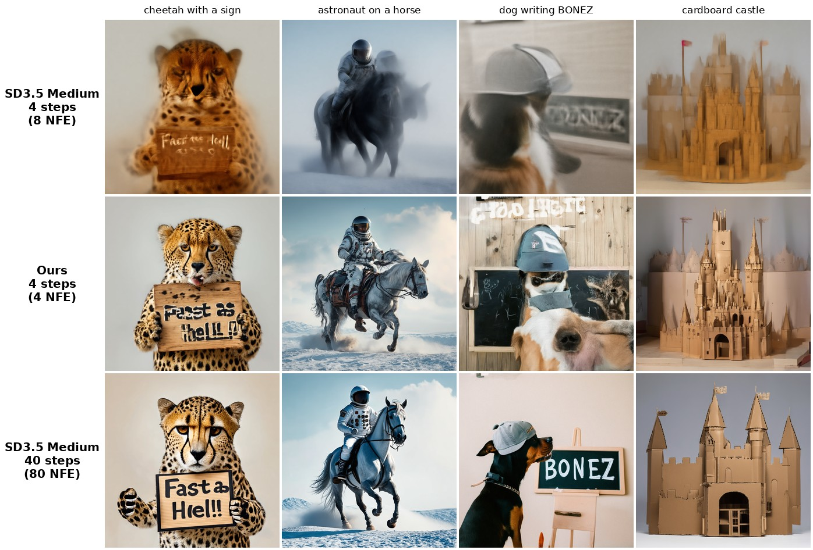
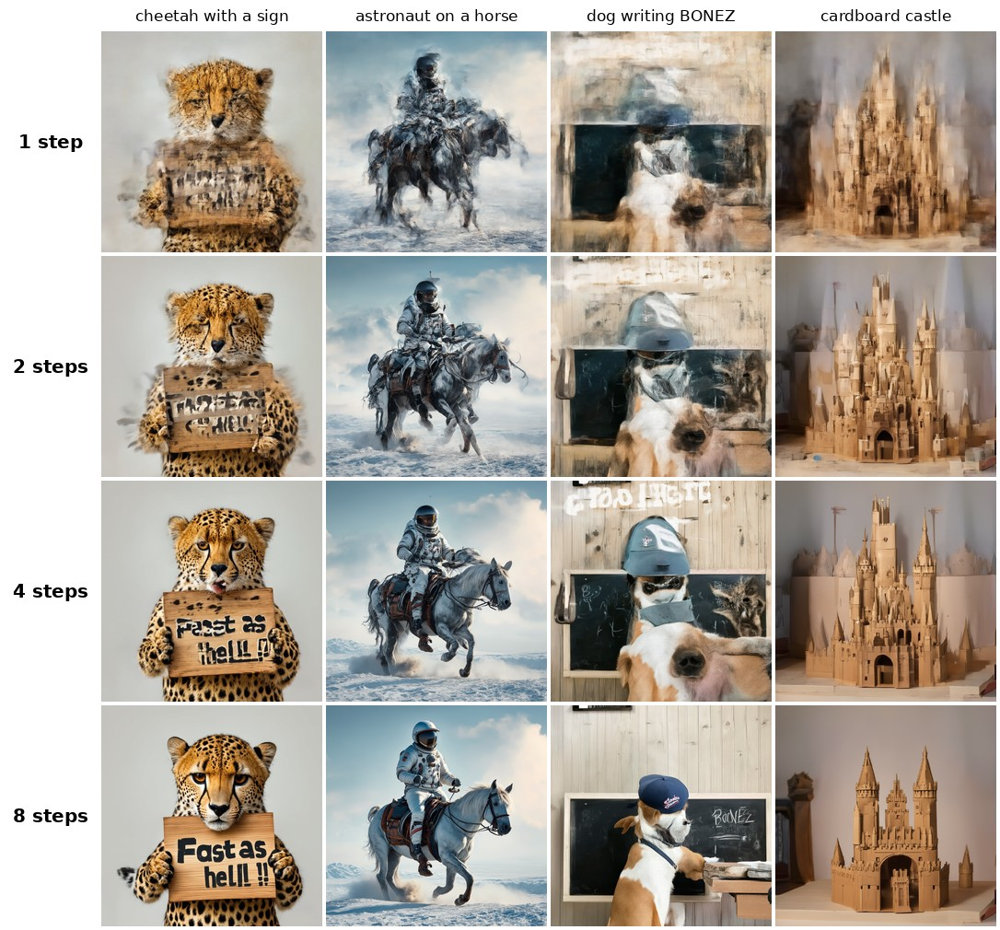

<div align="center">

# Shortcut Distillation of Stable Diffusion 3.5 Medium

**4-step text-to-image generation with SD3.5 Medium: a shortcut model trained as a LoRA adapter with a step-size embedding**

[](https://huggingface.co/suchotino/sd3.5-medium-shortcut-lora)
[](https://arxiv.org/abs/2410.12557)
[](https://huggingface.co/stabilityai/stable-diffusion-3.5-medium)
[](LICENSE)

</div>

The task: distil Stable Diffusion 3.5 Medium with the shortcut-model method, training a LoRA adapter on 3–5k images generated by the teacher, evaluate on the first 100 PartiPrompts, and get good images **in 4 steps**.

## Shortcut models

A diffusion or flow-matching model learns the instantaneous velocity of a noise-to-image ODE, so it needs many small steps. A **shortcut model** ([Frans et al., ICLR 2025](https://arxiv.org/abs/2410.12557)) is additionally conditioned on the **step size `d`** and learns where a jump of size `d` lands. It is trained with two losses at once:

- **flow matching** at `d = 0`, as in a regular model;
- **self-consistency**: one jump of size `2d` must equal two consecutive jumps of size `d`, so larger steps are learned from smaller ones without a separate teacher-student stage.

One network then samples with 1, 2, 4 or 8 steps.

<p align="center">
  
  <br><em>Figure from the official implementation, <a href="https://github.com/kvfrans/shortcut-models">kvfrans/shortcut-models</a> (MIT).</em>
</p>

## What we added to SD3.5 Medium

The 2.2B-parameter MMDiT-X transformer of SD3.5 Medium stays frozen. Two trainable modules are added (133M parameters in total):



- **Step-size embedder** (2.8M). The same sinusoidal embedding as SD3's timestep, followed by an MLP whose last layer starts at zero. Its output is added to the timestep + pooled-text embedding, which modulates every transformer block through adaLN, the way DiT shortcut models add `d` to `t`. Because it starts at zero, the untrained student is exactly the teacher ([SAM 3D](https://arxiv.org/abs/2511.16624) uses the same initialisation).
- **LoRA, rank 64, alpha 64** (130M) on the attention projections of the image and text streams, the extra image self-attention of the dual-attention blocks, the MLPs, and the adaLN projections where the step-size embedding enters.
- **Distilled guidance.** The teacher needs classifier-free guidance (CFG 4.5): two forward passes per step. The student learns the guided trajectory directly, so it makes **one pass per step: 4 passes instead of the teacher's 80** (40 steps × 2).

The implementation is in [`shortcut_sd35/shortcut.py`](shortcut_sd35/shortcut.py).

## Training

**Data.** 7,907 images at 1024² generated by the teacher (40 steps, CFG 4.5), stored as latents with their text embeddings. The prompts mix COCO captions, open-image-preferences, Lexica prompts and templated text-in-image prompts (signs, chalkboards, mugs), and none of them appears in PartiPrompts ([`data/`](data), [`scripts/prepare_prompts.py`](scripts/prepare_prompts.py)).

<details>
<summary>Training data by source</summary>

| source | dataset | steps 0–12k | added at 12k | total | share | words (median) | license |
|---|---|---:|---:|---:|---:|---:|---|
| COCO captions, Karpathy split | [`yerevann/coco-karpathy`](https://huggingface.co/datasets/yerevann/coco-karpathy) | 1,400 | 1,398 | 2,798 | 35.4% | 10 | CC BY 4.0 |
| open-image-preferences-v1 | [`data-is-better-together/open-image-preferences-v1-binarized`](https://huggingface.co/datasets/data-is-better-together/open-image-preferences-v1-binarized) | 1,200 | 1,200 | 2,400 | 30.4% | 26 | Apache-2.0 |
| Lexica SD prompts | [`Gustavosta/Stable-Diffusion-Prompts`](https://huggingface.co/datasets/Gustavosta/Stable-Diffusion-Prompts) | 598 | 598 | 1,196 | 15.1% | 35 | not stated |
| text-in-image templates | [`prepare_prompts.py`](scripts/prepare_prompts.py) | 784 | 729 | 1,513 | 19.1% | 11 | — |
| **total** | | **3,982** | **3,925** | **7,907** | | **12** | |

- COCO gives short compositional scenes close to the PartiPrompts style, open-image-preferences modern curated prompts, Lexica artistic styles, and the templates typography: two of the four task prompts need legible text.
- Every prompt is normalised and checked against all 1,632 PartiPrompts, not only the 100 used for evaluation; prompts have 3–60 words and are deduplicated.
- The source of every prompt is in [`data/prompts_v2_sources.jsonl`](data/prompts_v2_sources.jsonl) and [`data/prompts_v3_sources.jsonl`](data/prompts_v3_sources.jsonl). The prompts added at 12k were drawn with another seed and exclude both earlier corpora ([`data/prompts.txt`](data/prompts.txt) is the corpus of the 512² pilot).
</details>

**Objective** ([`scripts/train.py`](scripts/train.py)). In SD3's convention a teacher image $x_0$ is noised as $x_\sigma = (1-\sigma)\,x_0 + \sigma\,\varepsilon$ and the network predicts the velocity $\varepsilon - x_0$. The student $s_\theta(x, \sigma, d)$ takes the step size $d$ as an extra input; $v$ is the frozen teacher with guidance $w = 4.5$:

```math
v^{w}(x, \sigma) = v(x, \sigma, \varnothing) + w\,\bigl(v(x, \sigma, c) - v(x, \sigma, \varnothing)\bigr)
```

Half of each batch is **flow matching** at $d = 0$ against the teacher's guided velocity:

```math
\mathcal{L}_{\mathrm{FM}} = \mathbb{E}\,\bigl\lVert s_\theta(x_\sigma, \sigma, 0) - v^{w}(x_\sigma, \sigma) \bigr\rVert^2
```

The other half is **self-consistency** at $d \in \{1/16, 1/8, 1/4, 1/2, 1\}$ (a grid of $M = 32$ steps): one step of size $d$ from $\sigma_0$ must match two steps of size $d/2$, $\sigma_0 \to \sigma_1 \to \sigma_2$, made by the EMA student $s_{\theta^-}$:

```math
s_1 = s_{\theta^-}(x_{\sigma_0}, \sigma_0, \tfrac{d}{2}), \qquad
s_2 = s_{\theta^-}\bigl(x_{\sigma_0} - \Delta_1 s_1,\ \sigma_1,\ \tfrac{d}{2}\bigr), \qquad
\Delta_1 = \sigma_0 - \sigma_1,\ \ \Delta_2 = \sigma_1 - \sigma_2
```

```math
\mathcal{L}_{\mathrm{SC}} = \mathbb{E}\,\Bigl\lVert s_\theta(x_{\sigma_0}, \sigma_0, d) - \mathrm{sg}\Bigl(\frac{\Delta_1 s_1 + \Delta_2 s_2}{\Delta_1 + \Delta_2}\Bigr) \Bigr\rVert^2
```

- On SD3's shifted noise schedule the two half-steps have different lengths, so their velocities are averaged with the weights $\Delta_1, \Delta_2$. On a uniform grid this is the paper's $(s_1 + s_2)/2$.
- At the finest level $d = 1/16$ both half-steps come from the guided teacher $v^{w}$ instead of the student. This level anchors the whole hierarchy to the teacher and distils the guidance into every $d > 0$; it gets 40% of the self-consistency samples.
- $\mathrm{sg}$ is stop-gradient; the loss of a batch is the mean of both terms.

| setting | value |
|---|---|
| LoRA | rank 64, alpha 64 |
| optimizer | AdamW, lr 1e-4 (100 warm-up steps), weight decay 0.1, grad clip 1.0 |
| batch | 4 × 2 accumulation = 8 images at 1024², bf16 |
| EMA | 0.999 (targets and the released weights) |
| CFG distilled | 4.5, prompt dropout 0.1 |
| steps | 18,000: 6k on 3,982 images, +6k, +6k after adding 3,925 new images |
| compute | one H800 80 GB, 3.6–4.0 s/step, ≈ 18 GPU-hours of training |

## Results

<p align="center">
  
  <br><em>The four prompts of the task at 1024², same noise in each column.</em>
</p>

First 100 PartiPrompts, 1024², the same noise for every method. CLIP-I is the CLIP image similarity to the teacher's image; latency is the denoising time per image on one H800.

| method | steps | passes | CLIP score ↑ | PickScore ↑ | CLIP-I ↑ | latency, s |
|---|---:|---:|---:|---:|---:|---:|
| SD3.5 Medium, CFG 4.5 | 40 | 80 | 23.06 | 21.04 | 1.000 | 5.89 |
| SD3.5 Medium, CFG 4.5 | 4 | 8 | 21.12 | 20.07 | 0.701 | 0.56 |
| ours | 1 | 1 | 20.06 | 20.31 | 0.686 | 0.09 |
| ours | 2 | 2 | 20.75 | 20.70 | 0.765 | 0.17 |
| **ours** | **4** | **4** | **21.42** | **20.88** | **0.792** | **0.34** |
| ours | 8 | 8 | 21.92 | 20.98 | 0.815 | 0.69 |

With 4 steps the student is **17× faster than the teacher** and better than SD3.5 Medium with 4 steps on all three metrics, with half the forward passes. Its PickScore is 0.16 below the 40-step teacher.

<details>
<summary>832×480 (the format of the task's examples; training used only 1024²) and 1/2/4/8 steps</summary>

| method | steps | CLIP score ↑ | PickScore ↑ | CLIP-I ↑ |
|---|---:|---:|---:|---:|
| SD3.5 Medium | 40 | 22.98 | 20.91 | 1.000 |
| SD3.5 Medium | 4 | 21.99 | 20.14 | 0.749 |
| ours | 1 | 20.46 | 20.13 | 0.708 |
| ours | 2 | 21.76 | 20.55 | 0.792 |
| **ours** | **4** | **22.02** | **20.90** | **0.834** |
| ours | 8 | 22.49 | 20.98 | 0.852 |

<p align="center"></p>
</details>

### What we learned

| run | change | PickScore, 4 steps |
|---|---|---:|
| 2 | 1024², flow matching on the data, CFG 3.0 distilled | 20.72 |
| 2b | +6k steps, +3.9k images | 20.75 |
| 3 | `d = 0` on the teacher's guided velocity, CFG 4.5, 40% of samples on the anchor level | 20.81 |
| 3b | +6k steps | 20.89 |
| **3c (released)** | +6k steps, +3.9k images | **20.88** |

- **The guidance was the bottleneck.** [`scripts/diagnose_guidance.py`](scripts/diagnose_guidance.py) projects the student's prediction onto the teacher's guidance direction. Runs 2/2b had learned only 46% of the guidance at the anchor level; run 3 learned 66% and beat run 2b with half the steps and data.
- **More training helps 1–2 steps, not 4.** From 12k to 18k steps and with twice the data, the 4-step metrics stay within noise, while the 1-step CLIP score rises by 0.25–0.3.
- **Mid-noise guidance is the remaining gap.** At high noise the student reproduces ~70% of the teacher's guidance, at mid noise ~25%. Weighting the loss by the size of the guidance signal did not change this (a separate 1k-step test). This mid-noise gap is where letters and object boundaries form, which matches the remaining artefacts: imperfect text at 4 steps and fused parts in complex scenes such as the dog prompt.

## Usage

The weights are on the Hugging Face Hub: [suchotino/sd3.5-medium-shortcut-lora](https://huggingface.co/suchotino/sd3.5-medium-shortcut-lora). They are loaded on top of SD3.5 Medium, so accept its [license](https://huggingface.co/stabilityai/stable-diffusion-3.5-medium) on the Hub and log in with `hf auth login`.

```bash
git clone https://github.com/Suchotin/shortcut_distillation_sd3.5 && cd shortcut_distillation_sd3.5
bash setup_env.sh install                # Python 3.12 venv, torch for the installed driver
source ~/shortcut_work/shortcut_env.sh
hf auth login
python scripts/sample.py --steps 4 --prompt "A castle made of cardboard." "An astronaut riding a horse"
```

Images are written to `samples/`. `--student` also takes a local checkpoint directory.

## Training on another machine

Tested on Linux with one 80 GB GPU (H800) and about 70 GB of disk. GPUs with less than 60 GB of memory use gradient checkpointing automatically.

```bash
export ROOT=/path/to/workdir             # venv, model cache, data, runs
bash setup_env.sh install                # picks the torch CUDA build from the driver
bash setup_env.sh download               # SD3.5 Medium, CLIP, PickScore, PartiPrompts (hf auth login first)
bash setup_env.sh check                  # GPU, bf16, attention kernels

bash run_all.sh                          # teacher data (3,982 images) + 6k steps + evaluation
BASE_RUN=$ROOT/runs/shortcut_1024 RUN_NAME=shortcut_1024_12k STEPS=12000 bash run_continue.sh
BASE_RUN=$ROOT/runs/shortcut_1024_12k RUN_NAME=shortcut_1024_18k STEPS=18000 \
    EXTRA_PROMPTS=data/prompts_v3.txt bash run_continue.sh   # +3,925 images, the released model
```

Each run writes checkpoints, a `log.jsonl` with the losses per step size and validation grids of the task prompts to `$ROOT/runs/<name>`, and metrics and image grids to `$ROOT/eval/<name>`. A continued run restores the weights, EMA, optimizer and step counter.

Single steps:

```bash
python scripts/evaluate.py --student $ROOT/runs/shortcut_1024_18k/final/student_ema --out eval/x --pickscore
python scripts/diagnose_guidance.py --student <student_ema> --data_dir $ROOT/data/sd35m_1024
python tests/test_smoke.py               # CPU, tiny random SD3, ~2 min
python tests/toy_bimodal.py              # CPU, checks that shortcuts are learned on a toy problem
```

## Repository

```
shortcut_sd35/
  shortcut.py            step-size embedder, LoRA, losses, sampler, EMA
  data.py                sharded dataset of teacher latents and text embeddings
scripts/
  prepare_prompts.py     prompt corpus, disjoint from PartiPrompts
  generate_data.py       teacher generation
  train.py               distillation
  evaluate.py            PartiPrompts metrics and grids
  diagnose_guidance.py   how much guidance the student has learned
  sample.py              generate images with a trained student
  check_env.py           GPU check
run_all.sh, run_continue.sh, setup_env.sh
data/                    prompt corpora with the source of every prompt
tests/                   CPU smoke tests and the toy experiment
```

## Citation

```bibtex
@inproceedings{frans2025shortcut,
  title     = {One Step Diffusion via Shortcut Models},
  author    = {Frans, Kevin and Hafner, Danijar and Levine, Sergey and Abbeel, Pieter},
  booktitle = {International Conference on Learning Representations (ICLR)},
  year      = {2025}
}
```

## License

The code is MIT ([LICENSE](LICENSE)). The method figure is from [kvfrans/shortcut-models](https://github.com/kvfrans/shortcut-models), Copyright (c) 2024 Kevin Frans, MIT License. The released weights are derived from Stable Diffusion 3.5 Medium and follow the [Stability AI Community License](https://huggingface.co/stabilityai/stable-diffusion-3.5-medium). Prompt sources: COCO captions (CC BY 4.0), open-image-preferences-v1 (Apache-2.0), Lexica SD prompts, PartiPrompts (Apache-2.0).
