<div align="center">

# Shortcut Distillation of Stable Diffusion 3.5 Medium

**4-step text-to-image generation with SD3.5 Medium via shortcut-model self-consistency, trained as a LoRA adapter with an explicit step-size embedding**

[](https://www.python.org/)
[](https://pytorch.org/)
[](https://github.com/huggingface/diffusers)
[](https://huggingface.co/stabilityai/stable-diffusion-3.5-medium)
[](https://arxiv.org/abs/2410.12557)
[](LICENSE)

[Task](#1-task) · [Method](#2-method) · [Data](#3-data) · [Training](#4-training) · [Evaluation](#5-evaluation-protocol) · [Results](#6-results) · [Reproduce](#7-reproducing) · [Design decisions](#9-design-decisions-and-deviations) · [Citation](#13-citation)

</div>

---

## TL;DR

- **What.** A *shortcut model* (Frans et al., ICLR 2025) distilled from **Stable Diffusion 3.5 Medium**: the network is conditioned on the desired **step size `d`** and learns to jump along the probability-flow ODE, so one model samples in **1 / 2 / 4 / 8 steps**.
- **How.** Frozen 2.24B MMDiT-X + **LoRA r=64 (130M params, ~6%)** + a new **zero-initialised step-size embedder (2.8M)**. Loss = flow matching at `d=0` + self-consistency *"one 2d-jump = two d-jumps"*; classifier-free guidance is distilled into every `d>0`, so the student needs **one forward pass per step: 4 NFE vs. 80 NFE** for the teacher (40 steps × CFG). In the final run the `d=0` head regresses the teacher's guided velocity, and 40% of the self-consistency samples train the one level that is anchored to the teacher.
- **Data.** **~4k images generated by the teacher itself** per run (40 steps, CFG 4.5): 3,992 at 512² (run 1) and 3,982 at 1024² (run 2, reused by run 3), plus 3,925 more at 1024² for the continuation run 2b. The prompts come from a 4-source corpus that is **decontaminated against all 1,632 PartiPrompts**.
- **Evaluation.** First 100 PartiPrompts + the 4 prompts from the task statement; teacher (40 steps) vs. naive teacher (4 steps) vs. student (1/2/4/8 steps) under identical noise; CLIP score, PickScore, CLIP similarity to the teacher, latency; at 1024² and at the task's example format 832×480.
- **Result (final model = run 3, 1024²).** The 4-step student is **17× faster than the 40-step teacher** (0.34 vs. 5.89 s/img) and beats the naive 4-step teacher in all three metrics with half its NFE: **PickScore 20.81 vs. 20.07**, **fidelity to the teacher (CLIP-I) 0.779 vs. 0.701**, CLIP score 21.23 vs. 21.12. **Text rendering is still its weakest point** at 4 steps (the cheetah's sign is correct at 8), and the most complex task prompt can still fuse parts. Details and caveats in [§6](#6-results).
- **Key finding.** A diagnostic of how much classifier-free guidance a student has absorbed showed that runs 2 and 2b had learned less than half of it ([§6.3](#63-run-3-distilling-the-guidance)). Run 3 corrects the training signal and, with run 2's data and budget, beats run 2b (twice the steps and the data) in CLIP score and PickScore at 4 steps at both resolutions. It is weaker at 1 step.

<p align="center">
  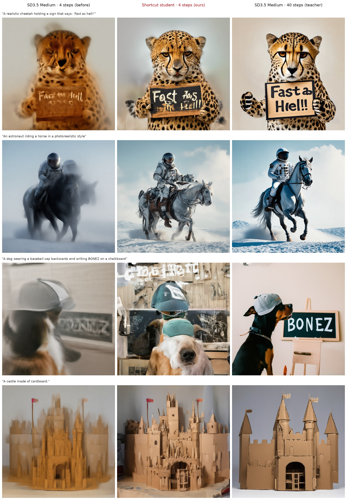
  <br><em>The four task prompts at 1024², same noise per row. Left: SD3.5 Medium with 4 steps (CFG 4.5, 8 NFE). Middle: shortcut student (run 3) with 4 steps (4 NFE). Right: the teacher with 40 steps (80 NFE).</em>
</p>

> [!NOTE]
> **Status.** Complete: code, data pipeline, four training runs on 1×H800 (512² pilot, 1024² main run, its continuation to 12,000 steps on twice the data, and run 3 with a corrected guidance distillation) and their evaluation. Tested with CPU smoke tests and a toy correctness experiment ([§10](#10-verification)).

---

## Contents

1. [Task](#1-task)
2. [Method](#2-method)
3. [Data](#3-data)
4. [Training](#4-training)
5. [Evaluation protocol](#5-evaluation-protocol)
6. [Results](#6-results)
7. [Reproducing](#7-reproducing)
8. [Repository structure](#8-repository-structure)
9. [Design decisions and deviations](#9-design-decisions-and-deviations)
10. [Verification](#10-verification)
11. [Compute and cost](#11-compute-and-cost)
12. [Limitations and future work](#12-limitations-and-future-work)
13. [Citation](#13-citation)
14. [Acknowledgements and licenses](#14-acknowledgements-and-licenses)

---

## 1. Task

The task statement (a one-page PDF, not redistributed in this repository) reads, verbatim:

> **Shortcut Distillation**
>
> Реализовать Shortcut дистилляцию на моделе Stable Diffusion 3.5 Medium. Для того, чтоб сделать обучение быстрее рекомендуем обучить LoRA адаптер.
> Данные нужно сгенерировать (достаточно 3-5k картинок). Статья: https://arxiv.org/pdf/2410.12557
>
> Бенчмарк: PartiPrompts (не обязательно генерировать все 1600 примеров, достаточно первых 100)
> Ожидаемый результат - подобные генерации за 4 шага.
>
> *"A realistic cheetah holding a sign that says: 'Fast as hell!'"* · *"An astronaut riding a horse in a photorealistic style"* · *"A dog wearing a baseball cap backwards and writing BONEZ on a chalkboard"* · *"A castle made of cardboard."*

**Translation.** Implement shortcut distillation of Stable Diffusion 3.5 Medium; training a LoRA adapter is recommended to make training faster. The data must be generated (3–5k images are enough). Paper: arXiv:2410.12557. Benchmark: PartiPrompts (the first 100 of ~1600 prompts are enough). Expected result: generations like the four examples above, **in 4 steps**.

### Requirement → implementation

| # | Requirement (task statement) | Implementation | Where |
|---|---|---|---|
| R1 | Shortcut distillation, arXiv:2410.12557 | Shortcut objective: flow matching at `d=0` + self-consistency over binary step sizes; explicit conditioning on `d` | [`shortcut_sd35/shortcut.py`](shortcut_sd35/shortcut.py), [`scripts/train.py`](scripts/train.py) |
| R2 | Stable Diffusion 3.5 Medium | `stabilityai/stable-diffusion-3.5-medium`, base weights frozen | — |
| R3 | LoRA adapter | LoRA r=64 on all 24 MMDiT-X blocks (130.4M params) + step-size embedder (2.8M) | [`shortcut.py`](shortcut_sd35/shortcut.py) |
| R4 | Generated data, 3–5k images | **3,992** (run 1, 512²) and **3,982** (runs 2 and 3, 1024²) teacher generations (latents + text embeddings); run 2b adds **3,925** more (7,907 at 1024²) | [`scripts/generate_data.py`](scripts/generate_data.py) |
| R5 | PartiPrompts, first 100 | First 100 rows of the official PartiPrompts set (HF mirror `nateraw/parti-prompts`, 1,632 prompts) | [`scripts/evaluate.py`](scripts/evaluate.py) |
| R6 | Results like the examples, in 4 steps | Student sampled with 4 steps (4 NFE, no CFG); dedicated grid on the 4 task prompts | [`scripts/evaluate.py`](scripts/evaluate.py) |

---

## 2. Method

### 2.1 Flow matching in the SD3 convention

SD3 is a rectified-flow model. With data $x_0$, noise $\varepsilon \sim \mathcal N(0, I)$ and noise level $\sigma \in [0, 1]$ ($\sigma = 1$ is pure noise):

$$
x_\sigma = (1-\sigma)\,x_0 + \sigma\,\varepsilon, \qquad v_\theta(x_\sigma, \sigma) \approx \varepsilon - x_0, \qquad x_{\sigma'} = x_\sigma + (\sigma' - \sigma)\, v_\theta(x_\sigma, \sigma).
$$

The shortcut paper uses the opposite time direction ($t = 0$ is noise); all formulas below are rewritten in the SD3 convention.

### 2.2 Shortcut models

A shortcut model $s_\theta(x_\sigma, \sigma, d)$ predicts the **average velocity over a jump of size $d$** rather than the instantaneous velocity. At $d = 0$ it is the ordinary flow model. Larger jumps are learned by **self-consistency**: one jump of size $2d$ must equal two consecutive jumps of size $d$. Each training batch mixes two losses (paper, Eq. 5 / Alg. 1):

$$
\mathcal L(\theta) =
\underbrace{\bigl\lVert s_\theta(x_\sigma, \sigma, 0) - (\varepsilon - x_0) \bigr\rVert^2}_{\text{flow matching, fraction } 1-k}
\;+\;
\underbrace{\bigl\lVert s_\theta(x_\sigma, \sigma, 2d) - \operatorname{sg}\bigl[s_{\text{target}}\bigr] \bigr\rVert^2}_{\text{self-consistency, fraction } k}
$$

with the bootstrap target built from two half-jumps of the **EMA** model:

$$
x' = x_\sigma - \Delta_1\, s_{\bar\theta}(x_\sigma, \sigma_0, d), \qquad
s_{\text{target}} = \frac{\Delta_1\, s_{\bar\theta}(x_\sigma, \sigma_0, d) + \Delta_2\, s_{\bar\theta}(x', \sigma_1, d)}{\Delta_1 + \Delta_2},
\qquad \Delta_1 = \sigma_0 - \sigma_1,\; \Delta_2 = \sigma_1 - \sigma_2 .
$$

As in the paper, step sizes are powers of two on a grid of $M$ steps, start times are multiples of the step size ("discrete time sampling"), and the second half-jump is queried at the **next** time $\sigma_1$ (Eq. 5 of the paper writes $t$; Algorithm 1 and the official code use $t + d$).

### 2.3 Adapting shortcut models to a pretrained SD3.5

| Question | Solution | Precedent |
|---|---|---|
| Non-uniform time grid (SD3 uses `shift = 3`) | `d` lives in uniform time $u$, with $\sigma(u) = 3u / (1 + 2u)$. Half-jumps have unequal $\sigma$-lengths, so the target is the **$\Delta\sigma$-weighted** average above. On a uniform grid it reduces exactly to the paper's $(s_1 + s_2)/2$ | MAGI-1, SCFM |
| How to feed `d` into a pretrained model | New **step-size embedder** (sinusoidal → MLP) whose **last layer is zero-initialised**; its output is added to SD3's `temb` (timestep + pooled text), which drives the adaLN modulation of every block. At initialisation, student ≡ teacher | SAM 3D (App. C.4); DiT shortcut models |
| What is trained | LoRA (r=64, α=64) on image/text attention (incl. the extra `attn2` self-attention of the first 13 MMDiT-X blocks), MLPs and adaLN projections, plus the step-size embedder; everything else frozen | SD3 paper (DPO-LoRA), SCFM |
| Classifier-free guidance | CFG (4.5 in runs 1 and 3, 3.0 in runs 2 and 2b) is applied **only at the base level** (half-jumps at $d=0$); through the recursion it is baked into all $d > 0$, so few-step sampling runs **without CFG** (1 NFE/step) | Official code, MAGI-1, SAM 3D |
| Base case of the recursion | Half-jumps at $d = 0$ are evaluated by the **frozen teacher** (same weights, adapter disabled); `--base_velocity ema` gives the paper's pure self-bootstrapped variant | [§9](#9-design-decisions-and-deviations) |
| Target of the $d = 0$ head (run 3) | `--fm_target teacher`: instead of the noisy data target $\varepsilon - x_0$, the head regresses the frozen teacher's **guided velocity** $v_u + w\,(v_c - v_u)$ at the same point (the unconditional velocity for dropped prompts). The target is deterministic, and the $d = 0$ head follows the same guided ODE as the base case of the recursion | stage 1 of guided distillation ([Meng et al., 2023](https://arxiv.org/abs/2210.03142)) |
| Level sampling (run 3) | `--anchor_fraction 0.4`: level 1, the finest jump and the only level trained against the teacher, gets 40% of the self-consistency samples, the other four levels 15% each (default: round-robin, 20% each) | [§6.3](#63-run-3-distilling-the-guidance) |

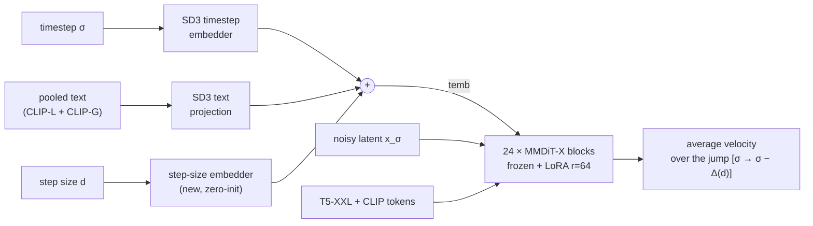

### 2.4 Sampling

For $n$ steps the sampler uses the shifted grid $\sigma_i = \sigma(1 - i/n)$ and $d = 1/n$:
$x \leftarrow x + (\sigma_{i+1} - \sigma_i)\, s_\theta(x, \sigma_i, d)$ — **one forward pass per step, no CFG**.
For $n \ge M$ the same model runs as the original flow model ($d = 0$, with CFG; without CFG for a run-3 student, whose $d = 0$ head has learned the guided velocity).

---

## 3. Data

### 3.1 Pipeline

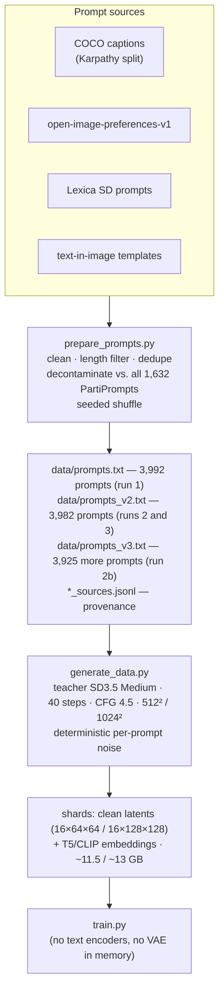

### 3.2 Prompt corpus

The task statement fixes the *images* (generated, 3–5k) but not the *prompts*. The corpus below is built to (i) resemble the benchmark's style without overlapping it, (ii) cover the visual styles that SD3.5 users actually request, and (iii) explicitly cover **text rendering**, which two of the four task examples require and which is the first capability to degrade in few-step students.

| Source | HF id | Run 1: prompts (share) | Run 2: prompts (share) | Run 2b, extra: prompts (share) | Words (median) | License | Why it is included |
|---|---|---:|---:|---:|---:|---|---|
| COCO captions, Karpathy split | [`yerevann/coco-karpathy`](https://huggingface.co/datasets/yerevann/coco-karpathy) | 1,598 (40.0%) | 1,400 (35.2%) | 1,398 (35.6%) | 10 | CC BY 4.0 (COCO annotations) | Short compositional scenes (objects, counts, relations) — closest in style to PartiPrompts; one random caption per image |
| open-image-preferences-v1 | [`data-is-better-together/open-image-preferences-v1-binarized`](https://huggingface.co/datasets/data-is-better-together/open-image-preferences-v1-binarized) | 1,400 (35.1%) | 1,200 (30.1%) | 1,200 (30.6%) | 26 | Apache-2.0 | Community-curated modern T2I prompts across many categories (photography, anime, digital art, …); only the `prompt` column is read |
| Lexica Stable Diffusion prompts | [`Gustavosta/Stable-Diffusion-Prompts`](https://huggingface.co/datasets/Gustavosta/Stable-Diffusion-Prompts) | 599 (15.0%) | 598 (15.0%) | 598 (15.2%) | 34–36 | unknown (per dataset card) | Breadth of artistic styles and artist references typical of SD prompting |
| Text-in-image templates | generated in [`prepare_prompts.py`](scripts/prepare_prompts.py) | 395 (9.9%) | **784 (19.7%)** | **729 (18.6%)** | 11 | — | Typography: *"X holding a sign that says '…'"*, *"… writing … on a chalkboard"*, mugs, neon signs, book covers |
| **Total** | | **3,992** | **3,982** | **3,925** | 13.5 / 12 / 12 | | |

Run 1 uses the default mix ([`data/prompts.txt`](data/prompts.txt)). Run 2 doubles the share of text-rendering prompts, because two of the four task prompts require legible text: `prepare_prompts.py --frac_coco 0.35 --frac_oip 0.30 --frac_lexica 0.15` (the rest is filled with templates) → [`data/prompts_v2.txt`](data/prompts_v2.txt). Run 2b trains on run 2's data plus fresh prompts with the same mix, drawn with seed 1 and excluding every prompt of both earlier corpora (`--exclude data/prompts.txt data/prompts_v2.txt`) → [`data/prompts_v3.txt`](data/prompts_v3.txt).

**Construction rules** ([`scripts/prepare_prompts.py`](scripts/prepare_prompts.py), seed 0, seed 1 for the run-2b extension, fully reproducible):

1. **Decontamination.** Every candidate is normalised (lower-case, alphanumerics only) and dropped if it matches **any of the 1,632 PartiPrompts** — not just the 100 used for evaluation.
2. **Length.** 3–60 words (T5 sees up to 256 tokens; CLIP truncates at 77).
3. **Deduplication** after normalisation; templates are re-drawn until the target size is reached.
4. **Provenance.** [`data/prompts_sources.jsonl`](data/prompts_sources.jsonl), [`data/prompts_v2_sources.jsonl`](data/prompts_v2_sources.jsonl) and [`data/prompts_v3_sources.jsonl`](data/prompts_v3_sources.jsonl) record the source of every prompt.
5. **No content filtering by default.** An optional `--filter` flag drops prompts that match a blocklist (sexual content, gore, weapons, drugs, extremism, politics, frequent celebrity names).

**Verified properties of all three corpora:** 0 PartiPrompts (of 1,632); 0 of the 4 task prompts; 0 near-duplicates of them (e.g. no "astronaut + horse" or "cardboard + castle" prompts); `prompts_v3.txt` shares no prompt with the two earlier corpora. Two of the four task prompts are themselves PartiPrompts, so benchmark decontamination also covers them.

### 3.3 Teacher generation

| Setting | Value | Rationale |
|---|---|---|
| Teacher | SD3.5 Medium, bf16 | task requirement |
| Sampler | `FlowMatchEulerDiscreteScheduler`, shift 3.0, **40 steps** | model-card recommendation |
| Guidance | CFG **4.5**, unconditional branch = empty prompt `""` | model-card recommendation; same null embedding is used for CFG distillation |
| Resolution | **512 × 512** (run 1) · **1024 × 1024** (runs 2, 2b and 3) | pilot vs. SD3.5 Medium's native resolution, see [§9](#9-design-decisions-and-deviations) and [§11](#11-compute-and-cost) |
| Text encoders | CLIP-L + OpenCLIP bigG + T5-XXL, `max_sequence_length = 256` | SD3.5 pipeline default |
| Noise | per-prompt deterministic: `seed = 1_000_003 · s + i` | independent of batch size / number of workers |
| Stored per sample | clean **latent in model space** (after the pipeline's own normalisation), T5+CLIP token embeddings, pooled embedding — all fp16 | training needs neither the VAE nor the 4.7B-parameter T5 |
| Storage | 8 safetensors shards, ~11.5 GB (512²) / ~13 GB (1024²); written atomically (resumable) | — |
| Throughput (measured, 1×H800 PCIe) | **0.82 img/s** at 512² (batch 16) → ~81 min · **0.18 img/s** at 1024² (batch 8) → ~6.1 h | [§11](#11-compute-and-cost) |

<p align="center">
  
  <br><em>Samples of the generated training data (teacher, 40 steps, CFG 4.5, 512²) for COCO/Lexica prompts:
  "a portrait of a evil dog dancing techno-style, cyberpunk concept art…", "A white sink sitting next to a toilet.",
  "A brown bear sitting against a tree with some leaves around him."</em>
</p>

Why teacher generations and not real images: the task requires generated data, and a distilled student must reproduce the **teacher's** distribution. Training on real photographs would instead fine-tune towards a different distribution.

---

## 4. Training

| Hyperparameter | Run 1 (512², pilot) | Run 2 (1024², main) | Run 3 (1024², final) | Source / note |
|---|---|---|---|---|
| Base grid $M$ (`--base_steps`) | 32 → student step sizes $d \in \{1/16, 1/8, \mathbf{1/4}, 1/2, 1\}$ | same | same | paper uses 128; see [§9](#9-design-decisions-and-deviations) |
| CFG distilled into $d > 0$ (`--cfg_scale`) | 4.5 | **3.0** | **4.5** | teacher data is always CFG 4.5; see [§9](#9-design-decisions-and-deviations) |
| Target of the $d = 0$ head (`--fm_target`) | $\varepsilon - x_0$ on the teacher's images | same | **the teacher's guided velocity** | paper: data; [§6.3](#63-run-3-distilling-the-guidance) |
| Self-consistency fraction $k$ | 0.25 | **0.5** | 0.5 | paper (0.25); SAM 3D |
| Level sampling | round-robin over all 5 levels, uniform start times on the level's grid | same | **level 1 (teacher-anchored) 40%**, the other 4 levels 15% each (`--anchor_fraction 0.4`) | official code: round-robin |
| EMA (bootstrap targets) | 0.999 | same | same | paper |
| Optimizer | AdamW, lr 1e-4 (100 warm-up steps, then constant), weight decay 0.1, grad-clip 1.0 | same | same | paper (weight decay "crucial for stability") |
| Prompt dropout in the FM branch | 0.1 (replaced by empty-prompt embedding) | same | same | keeps the unconditional branch alive |
| Batch × accumulation / steps | 8 × 1 / 6,000 | 4 × 2 / 6,000 (run 2b: continued to 12,000) | 4 × 2 / 6,000, fresh LoRA | effective batch 8, ~12 epochs over ~4k samples |
| Precision | bf16 autocast; LoRA + embedder master weights, Adam and EMA in fp32; TF32 enabled | same | same | — |
| Trainable parameters | LoRA 130.4M + step-size embedder 2.8M (base 2.24B frozen) | same | same | counted on the real config |
| Throughput (measured, 1×H800 PCIe, no gradient checkpointing) | **0.74 s/step**, 37.1 GB peak | **2.96 s/step**, 58.4 GB peak | **3.57 s/step**, 58.5 GB peak (the guided FM target costs two no-grad teacher passes per FM sample) | [§11](#11-compute-and-cost) |

**Run 2b** continues run 2 with every hyperparameter unchanged ([`run_continue.sh`](run_continue.sh)). It restores run 2's final checkpoint, including the LoRA, the step-size embedder, the EMA, the AdamW state, the LR schedule and the step counter, and trains from step 6,000 to 12,000 on 7,907 images (run 2's 3,982 plus 3,925 new ones generated with the same teacher settings). A new seed gives fresh noise, time and level draws. 6,000 more steps at effective batch 8 are about 6 epochs over the larger set.

**Run 3** starts from scratch (new LoRA and step-size embedder) on run 2's data, with run 2's batch, budget and seed. It changes three settings, each motivated by the guidance diagnostic of run 2b ([§6.3](#63-run-3-distilling-the-guidance)): CFG 4.5, the teacher's guided velocity as the target of the $d = 0$ head, and 40% of the self-consistency samples on level 1.

**Logged metrics** (TensorBoard via [`scripts/tb_sidecar.py`](scripts/tb_sidecar.py)): `loss/total`, `loss/flow_matching_d0`, `self_consistency/{01,02,04,08,16}_steps`, `train/grad_norm`, `train/lr`, `perf/*`, validation grids every 250 steps (run 3: every 500; rows = 1/2/4/8 steps, columns = the 4 task prompts), teacher-generation progress, final evaluation tables.

---

## 5. Evaluation protocol

**Prompts.** The first 100 PartiPrompts (as required) plus the 4 prompts of the task statement (qualitative grid).

> [!IMPORTANT]
> The first 100 PartiPrompts are all in the *Basic* challenge, 45 of them in the *Abstract* category, with a median length of **2 words** (*"bond"*, *"element"*, *"insight"*, *"an owl"*, …). They are much easier than the task's showcase prompts, which require multi-object scenes and text rendering. We therefore report the 4 task prompts separately.

**Resolutions.** Each run is evaluated at its training resolution (512² / 1024²) and at **832×480**, the format of the task's example images. At 832×480 the teacher and the naive baseline are identical for all runs (same noise), so all students are directly comparable there.

**Methods** — all with the **same initial noise per prompt**, so images are directly comparable:

| Method | Steps | CFG | NFE / image |
|---|---:|---|---:|
| Teacher (reference) | 40 | 4.5 | 80 |
| Naive teacher (the baseline to beat) | 4 | 4.5 | 8 |
| **Shortcut student** | 1 / 2 / **4** / 8 | distilled | 1 / 2 / **4** / 8 |

**Metrics.**

| Metric | Measures | Model |
|---|---|---|
| CLIP score ↑ | prompt alignment, $100 \cdot \max(\cos(\text{img}, \text{text}), 0)$ | `openai/clip-vit-large-patch14` |
| PickScore ↑ | human-preference proxy | `yuvalkirstain/PickScore_v1` |
| CLIP-I to teacher ↑ | fidelity to the 40-step teacher image from the same noise | CLIP-L image embeddings |
| Latency ↓ | transformer time per image (bf16, 1×H800 PCIe) | — |

---

## 6. Results

Four runs with the same code. Run 1 was a cheap pilot to validate the pipeline end to end. Run 2 is the main configuration. Run 2b continues run 2 for another 6,000 steps on twice the data. Run 3 retrains run 2's configuration from scratch with a corrected guidance distillation and is the final model.

| | Run 1 (pilot) | Run 2 (main) | Run 2b (run 2 continued) | Run 3 (final) |
|---|---|---|---|---|
| Data and training resolution | 512² | **1024²** (SD3.5 Medium's native resolution) | 1024² | 1024² |
| Prompt corpus | `prompts.txt`, 3,992, 10% text prompts | `prompts_v2.txt`, 3,982, **20% text prompts** | `prompts_v2.txt` + `prompts_v3.txt`, **7,907**, 19% text prompts | `prompts_v2.txt`, 3,982 (run 2's images) |
| Teacher data | 40 steps, CFG 4.5 | 40 steps, CFG 4.5 | same | same |
| CFG distilled into the student | 4.5 | **3.0** | 3.0 | **4.5** |
| Target of the $d = 0$ head | data | data | data | **the teacher's guided velocity** |
| Self-consistency fraction $k$ | 0.25 | **0.5** | 0.5 | 0.5 |
| Shortcut levels, effective batch | all 5 levels round-robin, 8 | same | same | all 5 levels, **40% on level 1**, 8 |
| Optimizer steps | 6,000 | 6,000 | **12,000** (6,000 from run 2 + 6,000) | 6,000, fresh LoRA |
| Wall-clock on 1×H800 | ≈ 3 h | ≈ 11.4 h | + ≈ 11.3 h | ≈ 6.2 h (no new data) |

**What changed after the pilot, and why.** Run 1 produced over-detailed, collage-like images, and its 4-step CLIP score fell below the naive baseline. We read this as distilled guidance that is too strong, so run 2 distils CFG 3.0. The data uses 1024², the model's native resolution, for more detail. The text-prompt share is doubled because two of the four task prompts require legible text. $k = 0.5$ gives the shortcut levels a larger share of each batch. All five step-size levels are kept, as in the paper. **Run 2b** then tests whether the remaining 4-step artefacts are a matter of training budget: same configuration, twice the steps and twice the images ([§6.2](#62-longer-training-run-2--run-2b)). **Run 3** tests the opposite reading of run 1: a guidance diagnostic showed that the students had absorbed too little guidance, not too much ([§6.3](#63-run-3-distilling-the-guidance)).

### 6.1 Main results: PartiPrompts (first 100)

**Run 3 at 1024²** (final model):

| Method | Steps | NFE | CLIP score ↑ | PickScore ↑ | CLIP-I to teacher ↑ | Latency, s/img ↓ | Speed-up |
|---|---:|---:|---:|---:|---:|---:|---:|
| Teacher, CFG 4.5 | 40 | 80 | 23.06 | 21.04 | 1.000 | 5.89 | 1× |
| Naive teacher, CFG 4.5 | 4 | 8 | 21.12 | 20.07 | 0.701 | 0.559 | 11× |
| Shortcut student | 1 | 1 | 18.41 | 19.92 | 0.620 | 0.085 | 69× |
| Shortcut student | 2 | 2 | 20.53 | 20.53 | 0.720 | 0.169 | 35× |
| **Shortcut student** | **4** | **4** | **21.23** | **20.81** | **0.779** | **0.340** | **17×** |
| Shortcut student | 8 | 8 | 21.38 | 20.93 | 0.804 | 0.682 | 8.6× |

**Run 3 at 832×480** (the task's example format; the student was trained on square 1024² only):

| Method | Steps | NFE | CLIP score ↑ | PickScore ↑ | CLIP-I to teacher ↑ | Latency, s/img ↓ | Speed-up |
|---|---:|---:|---:|---:|---:|---:|---:|
| Teacher, CFG 4.5 | 40 | 80 | 22.98 | 20.91 | 1.000 | 2.09 | 1× |
| Naive teacher, CFG 4.5 | 4 | 8 | 21.99 | 20.14 | 0.749 | 0.200 | 10× |
| Shortcut student | 1 | 1 | 18.97 | 19.81 | 0.643 | 0.033 | 64× |
| Shortcut student | 2 | 2 | 21.17 | 20.45 | 0.759 | 0.063 | 33× |
| **Shortcut student** | **4** | **4** | **21.64** | **20.84** | **0.814** | **0.126** | **17×** |
| Shortcut student | 8 | 8 | 22.17 | 20.93 | 0.841 | 0.252 | 8.3× |

The teacher and naive images are those of run 2b's evaluation (same prompts and noise, so the same images); their latencies were measured there.

**4-step student vs. the naive 4-step teacher**, all runs and resolutions (Δ = student − naive at the same resolution and noise):

| Run | Resolution | Δ CLIP score | Δ PickScore | CLIP-I to teacher: student / naive | Latency: student / naive |
|---|---|---:|---:|---|---|
| Run 1 | 512² | −0.64 | **+0.60** | **0.769** / 0.712 | 0.086 / 0.137 s |
| Run 1 | 832×480 | −0.84 | **+0.56** | **0.795** / 0.749 | 0.126 / 0.201 s |
| Run 2 | 1024² | −0.37 | **+0.65** | **0.770** / 0.701 | 0.337 / 0.564 s |
| Run 2 | 832×480 | −0.54 | **+0.54** | **0.803** / 0.749 | 0.125 / 0.199 s |
| Run 2b | 1024² | −0.13 | **+0.69** | **0.782** / 0.701 | 0.335 / 0.559 s |
| Run 2b | 832×480 | −0.40 | **+0.48** | **0.805** / 0.749 | 0.125 / 0.200 s |
| **Run 3** | **1024²** | **+0.12** | **+0.74** | **0.779** / 0.701 | 0.340 / 0.559 s |
| **Run 3** | **832×480** | −0.35 | **+0.71** | **0.814** / 0.749 | 0.126 / 0.200 s |

<details>
<summary>Run 2b (12,000 steps), run 2 (6,000 steps) and run 1 (512² pilot): full tables</summary>

**Run 2b, 1024²**

| Method | Steps | NFE | CLIP score ↑ | PickScore ↑ | CLIP-I to teacher ↑ | Latency, s/img ↓ |
|---|---:|---:|---:|---:|---:|---:|
| Teacher, CFG 4.5 | 40 | 80 | 23.06 | 21.04 | 1.000 | 5.89 |
| Naive teacher, CFG 4.5 | 4 | 8 | 21.12 | 20.07 | 0.701 | 0.559 |
| Shortcut student | 1 | 1 | 19.07 | 20.19 | 0.673 | 0.081 |
| Shortcut student | 2 | 2 | 20.41 | 20.55 | 0.747 | 0.163 |
| **Shortcut student** | **4** | **4** | **20.99** | **20.75** | **0.782** | **0.335** |
| Shortcut student | 8 | 8 | 21.94 | 20.84 | 0.800 | 0.687 |

**Run 2b, 832×480**

| Method | Steps | NFE | CLIP score ↑ | PickScore ↑ | CLIP-I to teacher ↑ | Latency, s/img ↓ |
|---|---:|---:|---:|---:|---:|---:|
| Teacher, CFG 4.5 | 40 | 80 | 22.98 | 20.91 | 1.000 | 2.09 |
| Naive teacher, CFG 4.5 | 4 | 8 | 21.99 | 20.14 | 0.749 | 0.200 |
| Shortcut student | 1 | 1 | 19.69 | 20.01 | 0.698 | 0.032 |
| Shortcut student | 2 | 2 | 21.34 | 20.40 | 0.771 | 0.062 |
| **Shortcut student** | **4** | **4** | **21.59** | **20.62** | **0.805** | **0.125** |
| Shortcut student | 8 | 8 | 21.75 | 20.69 | 0.814 | 0.257 |

**Run 2, 1024²**

| Method | Steps | NFE | CLIP score ↑ | PickScore ↑ | CLIP-I to teacher ↑ | Latency, s/img ↓ |
|---|---:|---:|---:|---:|---:|---:|
| Teacher, CFG 4.5 | 40 | 80 | 23.06 | 21.04 | 1.000 | 5.88 |
| Naive teacher, CFG 4.5 | 4 | 8 | 21.12 | 20.07 | 0.701 | 0.564 |
| Shortcut student | 1 | 1 | 18.33 | 20.03 | 0.623 | 0.081 |
| Shortcut student | 2 | 2 | 20.25 | 20.48 | 0.717 | 0.164 |
| **Shortcut student** | **4** | **4** | **20.74** | **20.72** | **0.770** | **0.337** |
| Shortcut student | 8 | 8 | 21.46 | 20.82 | 0.785 | 0.691 |

**Run 2, 832×480**

| Method | Steps | NFE | CLIP score ↑ | PickScore ↑ | CLIP-I to teacher ↑ | Latency, s/img ↓ |
|---|---:|---:|---:|---:|---:|---:|
| Teacher, CFG 4.5 | 40 | 80 | 22.98 | 20.91 | 1.000 | 2.09 |
| Naive teacher, CFG 4.5 | 4 | 8 | 21.99 | 20.14 | 0.749 | 0.199 |
| Shortcut student | 1 | 1 | 18.78 | 19.88 | 0.650 | 0.032 |
| Shortcut student | 2 | 2 | 20.86 | 20.40 | 0.752 | 0.062 |
| **Shortcut student** | **4** | **4** | **21.45** | **20.68** | **0.803** | **0.125** |
| Shortcut student | 8 | 8 | 21.89 | 20.82 | 0.827 | 0.258 |

**Run 1, 512²**

| Method | Steps | NFE | CLIP score ↑ | PickScore ↑ | CLIP-I to teacher ↑ | Latency, s/img ↓ |
|---|---:|---:|---:|---:|---:|---:|
| Teacher, CFG 4.5 | 40 | 80 | 23.29 | 21.00 | 1.000 | 1.435 |
| Naive teacher, CFG 4.5 | 4 | 8 | 22.31 | 20.21 | 0.712 | 0.137 |
| Shortcut student | 1 | 1 | 20.41 | 20.06 | 0.615 | 0.022 |
| Shortcut student | 2 | 2 | 21.73 | 20.50 | 0.725 | 0.042 |
| **Shortcut student** | **4** | **4** | **21.67** | **20.81** | **0.769** | **0.086** |
| Shortcut student | 8 | 8 | 22.37 | 20.92 | 0.793 | 0.177 |

**Run 1, 832×480**

| Method | Steps | NFE | CLIP score ↑ | PickScore ↑ | CLIP-I to teacher ↑ | Latency, s/img ↓ |
|---|---:|---:|---:|---:|---:|---:|
| Teacher, CFG 4.5 | 40 | 80 | 22.98 | 20.91 | 1.000 | 2.104 |
| Naive teacher, CFG 4.5 | 4 | 8 | 21.99 | 20.14 | 0.749 | 0.201 |
| Shortcut student | 1 | 1 | 19.52 | 19.88 | 0.634 | 0.032 |
| Shortcut student | 2 | 2 | 21.30 | 20.39 | 0.746 | 0.062 |
| **Shortcut student** | **4** | **4** | **21.15** | **20.70** | **0.795** | **0.126** |
| Shortcut student | 8 | 8 | 21.91 | 20.84 | 0.816 | 0.259 |

</details>

**Findings.**

1. **The student beats the naive 4-step teacher** in PickScore (+0.48 to +0.74) and in fidelity to the 40-step teacher (CLIP-I +0.05 to +0.08) in every run and at every resolution. It does so with **half the NFE**, because the student needs no CFG, so it is also 1.6–1.7× faster.
2. **Against the 40-step teacher**, the 4-step student of run 3 is **17× faster** and trails it by 0.24 PickScore at 1024² and by 0.06 at 832×480. With 8 steps the gap is 0.11 at 1024², and at 832×480 the student is level with the teacher (+0.02).
3. **CLIP score is the weak metric, and it is a text-rendering problem.** The first 100 PartiPrompts are mostly one- or two-word abstract prompts ([§5](#5-evaluation-protocol)). On these the teacher, and even the blurry naive baseline, often write the prompt word into the image (*"element"*, *"life"*; grid below), and CLIP rewards rendered text strongly. The student often omits the word: it draws a busy, collage-like scene (*"element"*) or only the object (*"life"*: a tree, without the word even at 8 steps). Run 2b's student writes both words at 8 steps (*"ELEMCENT"*, *"LiFE"*), which fits its higher 8-step CLIP score at 1024² (21.94 vs. 21.38). Across runs the 4-step gap to the naive baseline at 832×480 narrowed from −0.84 (run 1) to −0.54 (run 2), −0.40 (run 2b) and −0.35 (run 3). At 1024² run 3 is the first student above the naive baseline (+0.12).
4. **Run 2 vs. run 1 at 832×480** (same teacher, same noise): at 4 steps, CLIP score +0.30, CLIP-I +0.008, PickScore unchanged (20.68 vs. 20.70). At 1 and 2 steps run 2 has a lower CLIP score (−0.74 / −0.44), so the change mostly helps the 4- and 8-step regime that the task targets.
5. **Run 2b vs. run 2** (twice the steps and the data): the clearest gains are at 1 and 2 steps; at 4 and 8 steps the changes are small and not consistent across resolutions ([§6.2](#62-longer-training-run-2--run-2b)).
6. **Run 3 vs. runs 2 and 2b**: with run 2's data and budget, run 3 is better than run 2 at 2, 4 and 8 steps in 17 of 18 metric and resolution pairs. At 4 steps it is also better than run 2b in CLIP score and PickScore at both resolutions. At 1 step it is weaker than run 2b ([§6.3](#63-run-3-distilling-the-guidance)).
7. **Resolution and aspect-ratio transfer.** Runs 2, 2b and 3 were trained only on square 1024² images. At 832×480 they reach the highest fidelity to the teacher of all configurations: 0.814 at 4 steps and 0.841 at 8 (run 3).

<details>
<summary>First 8 PartiPrompts, run 3 at 1024²: teacher · naive 4 steps · student 1/2/4/8 steps</summary>

<p align="center">
  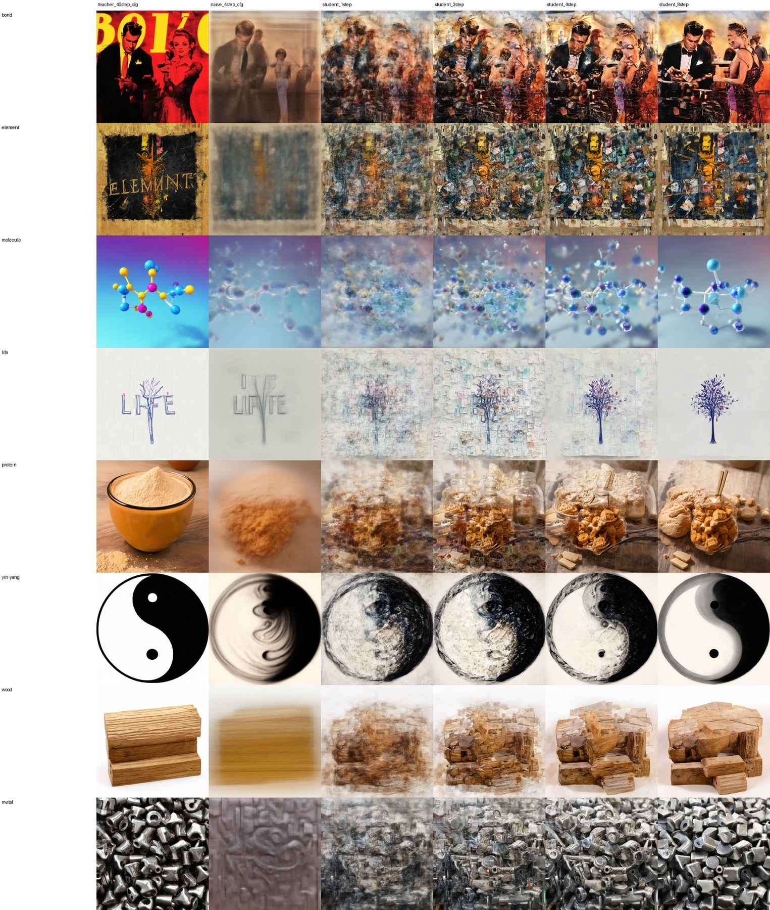
  <br><em>Rows: "bond", "element", "molecule", "life", "protein", "yin-yang", "wood", "metal". Columns: teacher 40 steps, naive 4 steps, student 1/2/4/8 steps (same noise per row).</em>
</p>

</details>

### 6.2 Longer training: run 2 → run 2b

After run 2 the most visible 4-step artefacts were fused parts (a dog's face merging with its cap, the astronaut's suit merging with the harness) and garbled text. These are typical of under-training, but also of the L2 objective itself: a large jump that cannot resolve which of several sharp images it leads to regresses towards their average, and each coarse level inherits the errors of the finer levels it is bootstrapped from. Run 2b separates the two explanations with the cheapest experiment. It continues run 2 with an unchanged configuration for another 6,000 steps on twice the data ([§4](#4-training)).

**Change from run 2 to run 2b** (same noise, same prompts; Δ = run 2b − run 2):

| Steps | 1024²: Δ CLIP score | Δ PickScore | Δ CLIP-I | 832×480: Δ CLIP score | Δ PickScore | Δ CLIP-I |
|---:|---:|---:|---:|---:|---:|---:|
| 1 | **+0.74** | **+0.16** | **+0.050** | **+0.91** | **+0.12** | **+0.048** |
| 2 | +0.16 | +0.06 | +0.030 | +0.47 | +0.00 | +0.019 |
| 4 | +0.24 | +0.04 | +0.012 | +0.14 | −0.06 | +0.002 |
| 8 | +0.48 | +0.03 | +0.014 | −0.14 | −0.13 | −0.013 |

- **The coarse levels gain most.** At 1 step CLIP-I rises by 0.05 at both resolutions, and CLIP score by 0.7 to 0.9. This fits the bootstrap structure: the 1- and 2-step levels learn from the finer levels, which kept improving.
- **At 4 and 8 steps the effect is small.** At 1024² all three metrics improve slightly; at 832×480 they are flat or slightly worse. With 100 prompts and a single training seed, differences of this size should not be over-interpreted ([§12](#12-limitations-and-future-work)).
- **The fused parts remain.** On the task prompts the two students are almost identical (figure in [§6.3](#63-run-3-distilling-the-guidance)). The cheetah's sign is a little cleaner and the astronaut is a little sharper, but the dog's cap still merges with a striped band across its muzzle, and a second dog head appears in the background. On the fixed validation noise the change is more visible ([§6.6](#66-training-dynamics)), so it depends on the seed.
- **Conclusion.** Twice the training budget does not remove the 4-step artefacts, so they are not a matter of training length. We first concluded that they come from the L2 objective itself. The guidance diagnostic of the next section points to a more specific cause, which a different training signal partly fixes without changing the form of the objective.

### 6.3 Run 3: distilling the guidance

Classifier-free guidance enters the shortcut levels only through the base case of the recursion. Level 1, the finest jump ($d = 1/16$), is trained against two guided half-steps of the teacher, and every coarser level inherits the guidance from the level below it. [`scripts/diagnose_guidance.py`](scripts/diagnose_guidance.py) measures how much of it a trained student has absorbed. At training states $x_\sigma$ it projects the student's prediction $s$ onto the teacher's guidance direction:

$$
w_\text{eff} = 1 + \frac{\langle s - v_c,\; v_c - v_u \rangle}{\lVert v_c - v_u \rVert^2},
$$

where $v_c$ and $v_u$ are the teacher's conditional and unconditional velocities at the same point. $w_\text{eff} = 1$ means no guidance: the student behaves like the conditional teacher. $w_\text{eff} = w$ means the guidance is fully distilled. The level-1 target is measured in the same way as a reference. It is not exactly $w$, because its second half-step is evaluated at a different point.

**Effective guidance of the final students**, pooled over 64 training states (per noise band in `guidance.json`):

| | Run 2b (CFG 3.0) | Run 3 (CFG 4.5) |
|---|---:|---:|
| $d = 0$ head | 1.46 | 2.87 |
| Level-1 head ($d = 1/16$) | 1.73 | 2.57 |
| Level-1 target (reference) | 2.58 | 3.37 |
| Share of the target's guidance learned at level 1, $(w_\text{eff} - 1) / (w_\text{target} - 1)$ | **46%** | **66%** |
| Level-1 loss: student / conditional teacher (= untrained student) | 0.023 / 0.041 | 0.048 / 0.102 |

Run 2b had absorbed less than half of the guidance in its level-1 target, and its $d = 0$ head, trained on the noisy data target, was only weakly guided. The deficit was largest at mid and low noise: at $0.4 \le \sigma < 0.75$ the level-1 head reached 1.34 against 2.66 in its target. The reading of run 1 that motivated CFG 3.0 ([§6](#6-results)) assumed too much distilled guidance; in run 2b the opposite holds. Run 3 keeps run 2's data, batch, budget and seed and changes three settings:

1. **CFG 4.5**, the teacher's own scale, which also generated the training images.
2. **The teacher's guided velocity as the target of the $d = 0$ head** (`--fm_target teacher`). The data target $\varepsilon - x_0$ is noisy and describes the flow of the CFG-generated images, not the guided ODE that the shortcut levels integrate. The teacher's guided velocity is deterministic and belongs to that ODE.
3. **40% of the self-consistency samples on level 1** (`--anchor_fraction 0.4`). With round-robin over five levels, the only level that sees the teacher gets 10% of each batch ($k = 0.5$); run 3 gives it 20%.

The level-1 head now carries 66% of its target's guidance instead of 46%, and the $d = 0$ head is strongly guided (2.87 of 4.5).

**Change from run 2 to run 3** (same data and budget; same noise and prompts; Δ = run 3 − run 2):

| Steps | 1024²: Δ CLIP score | Δ PickScore | Δ CLIP-I | 832×480: Δ CLIP score | Δ PickScore | Δ CLIP-I |
|---:|---:|---:|---:|---:|---:|---:|
| 1 | +0.08 | −0.10 | −0.003 | +0.19 | −0.07 | −0.006 |
| 2 | **+0.28** | +0.04 | +0.004 | **+0.31** | +0.05 | +0.007 |
| 4 | **+0.49** | **+0.09** | **+0.009** | **+0.19** | **+0.17** | **+0.011** |
| 8 | −0.09 | **+0.12** | **+0.018** | **+0.28** | **+0.11** | **+0.014** |

**Change from run 2b to run 3** (run 3 has half the steps and half the images; Δ = run 3 − run 2b):

| Steps | 1024²: Δ CLIP score | Δ PickScore | Δ CLIP-I | 832×480: Δ CLIP score | Δ PickScore | Δ CLIP-I |
|---:|---:|---:|---:|---:|---:|---:|
| 1 | −0.66 | −0.26 | −0.053 | −0.72 | −0.19 | −0.054 |
| 2 | +0.12 | −0.02 | −0.027 | −0.17 | +0.05 | −0.012 |
| 4 | **+0.25** | **+0.05** | −0.003 | **+0.05** | **+0.23** | **+0.009** |
| 8 | −0.57 | +0.09 | +0.004 | **+0.42** | **+0.24** | **+0.027** |

<p align="center">
  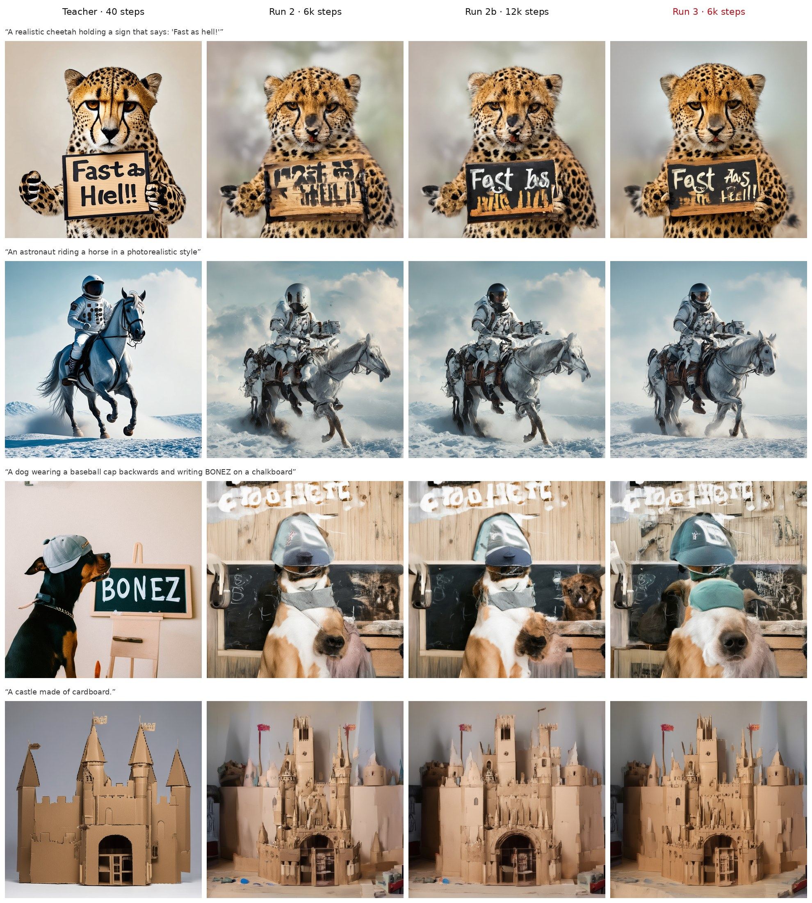
  <br><em>The task prompts at 1024², 4 steps, same noise: run 2 (6,000 steps), run 2b (12,000 steps on twice the data) and run 3 (6,000 steps, corrected guidance distillation).</em>
</p>

- **Same budget, better few-step model.** Against run 2, run 3 is better at 2, 4 and 8 steps in 17 of 18 metric and resolution pairs; the exception is the 8-step CLIP score at 1024² (−0.09). At 1 step the two are on par.
- **Against run 2b, run 3 wins at 4 steps** in CLIP score and PickScore at both resolutions, with equal fidelity to the teacher (CLIP-I −0.003 / +0.009). It also wins at 8 steps at 832×480.
- **The 1-step level lags behind.** It is the level that gained most from run 2b's extra training ([§6.2](#62-longer-training-run-2--run-2b)): coarse levels are bootstrapped from the finer ones and converge last, and run 3 has had half of run 2b's steps.
- **On the task prompts** the clearest change is text: the cheetah's sign reads "Fast Aas … Hell!" at 4 steps (run 2b: "Fast bs" over a garbled line) and "Fast as hell" at 8 steps ([§6.4](#64-task-prompts-qualitative)). The dog prompt remains the hardest. All three students put a capped dog in front of the chalkboard, but each fuses something into its face: a striped band in runs 2 and 2b, a second cap in run 3. None writes "BONEZ".
- **Caveats.** Run 3 changes three settings at once, and each configuration was trained once, so the contribution of each change is not separated. The diagnostic is pooled over 64 states of the training data.

### 6.4 Task prompts (qualitative)

Same noise per row; the 4 prompts are those of the task statement.

<p align="center">
  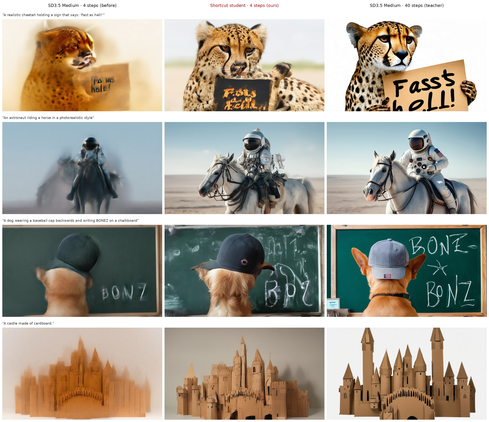
  <br><em>Run 3, 832×480 (the format of the task's examples). Left: SD3.5 Medium with 4 steps (CFG 4.5). Middle: shortcut student with 4 steps. Right: teacher with 40 steps. The 1024² version is shown at the top of this README.</em>
</p>

<p align="center">
  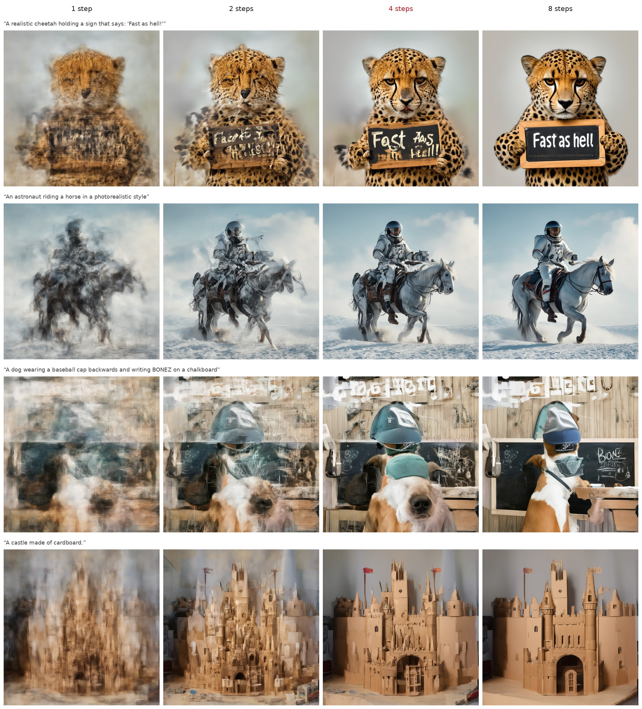
  <br><em>One model, different step budgets (run 3, 1024², same noise). The sign is partly legible at 4 steps and reads "Fast as hell" at 8 steps.</em>
</p>

**Honest assessment against the task's expectation ("similar generations in 4 steps").** At 4 steps the student reproduces the composition, materials and photographic style of all four prompts, and it is far sharper than the 4-step teacher, which is hazy and ghosted. At 832×480 its dog faces the chalkboard with the cap on, as in the teacher's image. It does not reach the teacher's 40-step quality:

- **Text is the weakest point.** At 4 steps signs and chalkboards are partly legible ("Fasts a Hell", "BPZ" at 832×480). At 8 steps the cheetah's sign is correct.
- **Parts of complex scenes can fuse** at 4 steps, most visibly in the dog prompt at 1024², where a second cap covers the dog's eyes.
- **Many-part objects can be over-detailed**, for example the turrets of the cardboard castle.

<details>
<summary>Run 1 (512² pilot): same comparison</summary>

<p align="center">
  
  <br><em>Run 1, 512².</em>
</p>
<p align="center">
  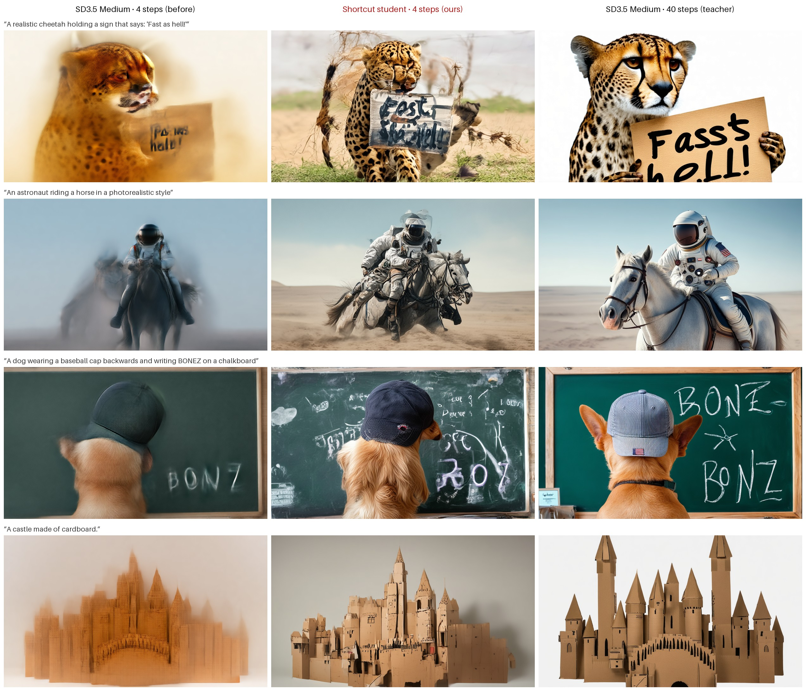
  <br><em>Run 1, 832×480.</em>
</p>

</details>

### 6.5 Baseline: the teacher with few steps

<p align="center">
  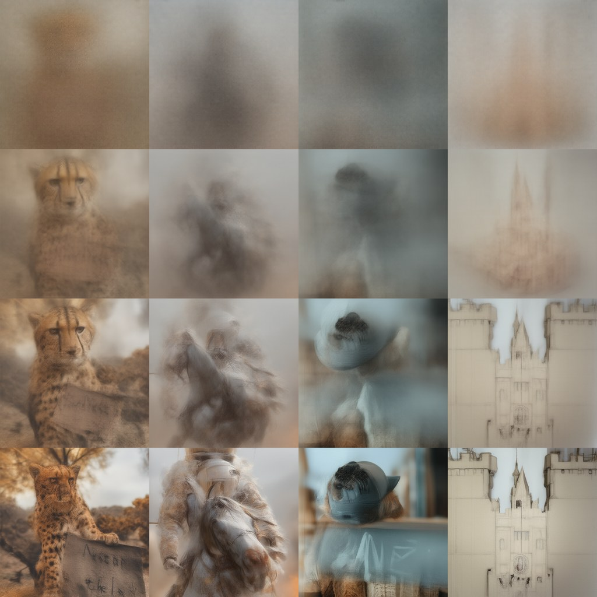
  <br><em>Starting point of training (step 0 = the teacher, since the step-size embedder is zero-initialised).
  Rows: 1, 2, 4, 8 Euler steps without CFG; columns: the four task prompts.
  One step collapses to the conditional mean (cf. Fig. 2 of the paper); 4–8 steps are hazy and the text is unreadable.</em>
</p>

### 6.6 Training dynamics

<p align="center">
  
  <br><em>Thin lines: logged values (every 10 steps); thick lines: exponential moving average. Run 2b resumes run 2 at step 6,000 (dashed line). Absolute loss values are not comparable across resolutions and guidance scales, and run 3's flow-matching loss has a different target (the teacher's guided velocity instead of the noisy data target).</em>
</p>

- **Flow-matching loss.** In runs 1, 2 and 2b the $d=0$ head is initialised as the teacher and trained on the teacher's own samples, so it starts at its noise floor and stays flat (0.234 in steps 5–6k, 0.231 in steps 11–12k). Being flat means the LoRA does not damage the base model. In run 3 the target is the teacher's guided velocity, which has no noise floor. The loss starts at the gap between the conditional and the guided velocity and falls by more than half as the head learns the guidance (0.11 at step 10, 0.046 in the last 500 steps).
- **Anchor level ($d = 1/16$).** Its target comes directly from the frozen teacher. In run 2 (CFG 3.0) the loss is flat at about 0.024. In runs 1 and 3 (CFG 4.5) it starts higher, at 0.14–0.16, because the guided target is further from the untrained student. Run 3, with 20% of all samples on this level, brings it to 0.04 within 1,000 steps. Run 1, with 5%, stays near 0.10.
- **The self-consistency loss rises slowly at the bootstrapped levels.** The rise is larger for coarser jumps (1-step level of run 2: 0.007 in the first 500 steps → 0.027 at 6k → 0.030 at 12k; run 3: 0.013 → 0.036 at 6k). This is expected for bootstrapped targets: as the finer levels learn, the targets for the coarser levels move from a blurry conditional mean towards sharp images, so the targets are not stationary. The 4-step level shown in the plot levels off in run 2b and ends slightly lower (0.0089 in steps 5–6k, 0.0077 in steps 11–12k). The bootstrapped levels of run 3 sit higher than those of run 2 (4-step level 0.014 in steps 5–6k), as expected for targets that carry more guidance.
- **The gradient norm is stable**: about 0.1 in runs 1, 2 and 2b and about 0.2 in run 3, well below the clipping threshold of 1.0, with no divergence in any run. After warm-up there are single logged spikes (run 1 near step 1,200; run 2b to 1.02 at step 9,210; run 3 to 0.60 at step 350), each followed by a normal value.

<p align="center">
  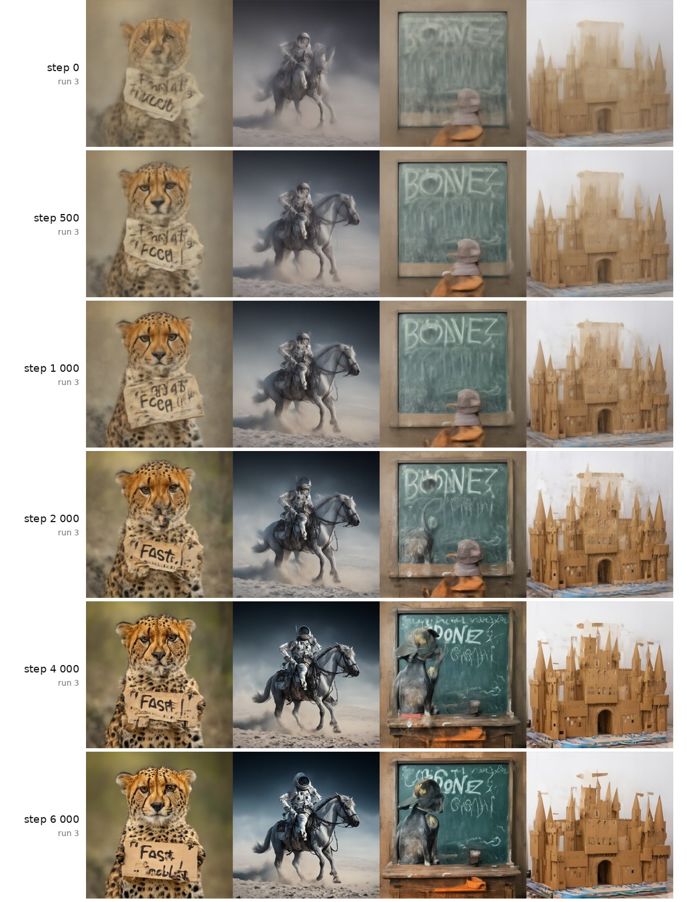
  <br><em>Run 3: 4-step samples from the validation grid during training (fixed noise; validation noise differs from the evaluation noise above). Step 0 is the teacher with 4 Euler steps and no CFG. By step 2,000 the haze is gone and the sign reads "Fast"; by step 4,000 the astronaut and the horse are sharp, and a dog in a cap stands at the chalkboard, which reads "…ONEZ".</em>
</p>

<details>
<summary>Run 2 → 2b: the same validation strip</summary>

<p align="center">
  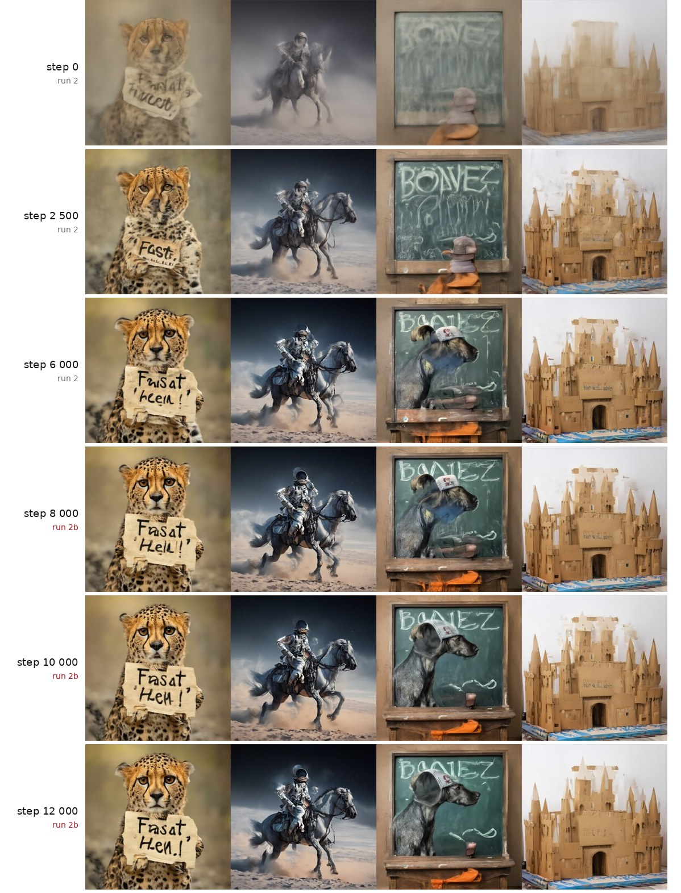
  <br><em>Steps after 6,000 are run 2b. Over run 2 the samples become sharper, gain contrast and acquire a sign with partly legible text. In run 2b the dog's head separates from the cap and the chalkboard text moves towards "BONEZ".</em>
</p>

</details>

### 6.7 Sanity check: shortcut learning on a toy problem

[`tests/toy_bimodal.py`](tests/toy_bimodal.py) pretrains a tiny SD3-architecture flow model on bimodal data (every latent is all +1 or all −1) and then distils it with the real `train.py`. Comparison with the teacher's 32-step ODE solution from the same noise:

| | 1 step: on-mode / MSE | 2 steps: on-mode / MSE | 4 steps: on-mode / MSE |
|---|---|---|---|
| Teacher, naive Euler | 34% / 0.556 | 92% / 0.087 | 100% / 0.031 |
| **Shortcut student** | **86% / 0.246** | **98%** / 0.128 | 100% / 0.079 |

Naive one-step Euler collapses to the mean of the two modes; the shortcut student does not. This verifies the objective, not image quality on SD3.5.

---

## 7. Reproducing

### 7.1 Software stack

| Component | Version | Note |
|---|---|---|
| Python | 3.12 | numpy 2.5 requires ≥ 3.12 |
| PyTorch | **2.15.0 + cu132** | wheel ships CUDA 13.2.2, cuDNN 9.26, NCCL; needs a driver with CUDA ≥ 13.2 |
| PyTorch (fallback) | 2.14.1 + cu126 | for CUDA 12.x drivers (`TORCH_CU=cu126`); also passes all tests |
| CUDA toolkit / nvcc | **not required** | no custom kernels; attention via PyTorch SDPA (FlashAttention-2 / cuDNN on Hopper) |
| diffusers · transformers · peft · accelerate | 0.43.0 · 5.23.0 · 0.22.0 · 1.16.0 | exact pins in [`requirements.txt`](requirements.txt) |

### 7.2 Quick start (any Linux box with one ≥ 24 GB GPU)

```bash
pip install torch==2.15.0 --index-url https://download.pytorch.org/whl/cu132   # or 2.14.1/cu126
pip install -r requirements.txt
hf auth login                      # account that accepted the SD3.5 Medium license
bash run_all.sh                    # run 1 (512² pilot): data → training → evaluation
```

Run 2 (the main result) is the same pipeline with different settings:

```bash
RES=1024 PROMPTS=data/prompts_v2.txt RUN_NAME=shortcut_1024_v2 DATA=$ROOT/data/sd35m_1024_v2 \
BATCH=4 ACCUM=2 GEN_BS=8 TRAIN_ARGS="--cfg_scale 3.0 --bootstrap_fraction 0.5" \
EVAL_SIZES="1024x1024 832x480" bash run_all.sh
```

Run 3 (the final model) is run 2's pipeline with the corrected guidance distillation. It reuses run 2's data: the generation step skips the existing shards and only re-encodes the empty prompt and the 4 task prompts into the small files next to them. The diagnostic of [§6.3](#63-run-3-distilling-the-guidance) runs on any trained student:

```bash
RES=1024 PROMPTS=data/prompts_v2.txt RUN_NAME=shortcut_1024_run3 DATA=$ROOT/data/sd35m_1024_v2 \
BATCH=4 ACCUM=2 GEN_BS=8 TRAIN_ARGS="--bootstrap_fraction 0.5 --fm_target teacher --anchor_fraction 0.4" \
EVAL_SIZES="1024x1024 832x480" bash run_all.sh
python scripts/diagnose_guidance.py --student $ROOT/runs/shortcut_1024_run3/final/student_ema \
    --data_dir $ROOT/data/sd35m_1024_v2 --n 64 --out $ROOT/runs/shortcut_1024_run3/guidance.json
```

Run 2b continues run 2 from its final checkpoint. The script generates the extra teacher data, links both shard sets into one data directory, resumes training to 12,000 steps and evaluates. Its defaults are exactly run 2b, and all settings are environment variables documented at the top of the script:

```bash
python scripts/prepare_prompts.py --out data/prompts_v3.txt --sources_out data/prompts_v3_sources.jsonl \
    --total 4000 --frac_coco 0.35 --frac_oip 0.30 --frac_lexica 0.15 --seed 1 \
    --exclude data/prompts.txt data/prompts_v2.txt          # optional: the file is in the repository
bash run_continue.sh
```

Outputs: `runs/<RUN_NAME>/final/student_ema` (LoRA + step-size embedder, 272 MB; `final` links to the last checkpoint) and `eval/<RUN_NAME>/<W>x<H>/` (`metrics.md`, grids, images). All settings of `run_all.sh` are environment variables, documented at the top of the script.

`run_all.sh` uses all visible GPUs (data generation is sharded across GPUs, training runs with DDP) and picks per-GPU defaults ([`scripts/gpu_defaults.sh`](scripts/gpu_defaults.sh)): on ≥ 60 GB GPUs gradient checkpointing is off and the generation batch is 16.

### 7.3 Remote GPU box, step by step

```bash
export ROOT=/path/to/big/disk         # venv, HF cache, data, runs (≥ 60 GB free)
bash setup_env.sh install             # (no GPU needed) Python 3.12 venv + torch build matched to the host driver
source $ROOT/shortcut_env.sh
hf auth login                         # or put the token into $HF_HOME/token
bash setup_env.sh download            # (no GPU needed) SD3.5 Medium (diffusers folders only), metric models, PartiPrompts
bash setup_env.sh check               # driver / CUDA / sm_90 / bf16 TFLOPS / attention kernels
bash setup_env.sh bench               # ~5 min: 64 teacher images + 30 train steps → measured ETA and cost
mkdir -p logs && nohup bash run_all.sh > logs/run_all.log 2>&1 &   # prefix with the run-2 variables above for 1024²
```

Optional: `NETWORK_SETUP=/path/to/proxy.sh` is sourced before downloads; `HF_ENDPOINT` is honoured as usual.

### 7.4 Using a trained student

```python
import torch
from diffusers import StableDiffusion3Pipeline
from shortcut_sd35.shortcut import load_student, shortcut_sample

pipe = StableDiffusion3Pipeline.from_pretrained(
    "stabilityai/stable-diffusion-3.5-medium", torch_dtype=torch.bfloat16).to("cuda")
student, cfg = load_student("runs/shortcut_1024_run3/final/student_ema", pipe.transformer)

pe, _, pp, _ = pipe.encode_prompt("A castle made of cardboard.", None, None,
                                  do_classifier_free_guidance=False)
noise = torch.randn(1, 16, 128, 128, device="cuda")   # latent of a 1024×1024 image (H/8 × W/8)
with torch.no_grad(), torch.autocast("cuda", dtype=torch.bfloat16):
    latents = shortcut_sample(student, noise, pe, pp, num_steps=4, cfg=cfg)   # 4 NFE, no CFG
    latents = latents / pipe.vae.config.scaling_factor + pipe.vae.config.shift_factor
    image = pipe.vae.decode(latents.to(pipe.vae.dtype)).sample
pipe.image_processor.postprocess(image)[0].save("castle_4steps.png")
```

---

## 8. Repository structure

```
shortcut_sd35/
  shortcut.py            step-size embedder, ShortcutSD3 wrapper, time grid, self-consistency targets,
                         sampler, EMA, LoRA save/load
  data.py                lazy shard dataset (safetensors slicing), task showcase prompts
scripts/
  prepare_prompts.py     prompt corpus (4 sources, decontamination, provenance)
  generate_data.py       teacher generation → latents + text embeddings (GPU-sharded, resumable)
  train.py               shortcut distillation (accelerate / DDP)
  evaluate.py            PartiPrompts evaluation: metrics + grids
  diagnose_guidance.py   how much classifier-free guidance a trained student has absorbed (w_eff)
  tb_sidecar.py          mirrors run logs into TensorBoard
  check_env.py           GPU / CUDA / torch sanity check
  bench_report.py        full-run ETA and cost from a 5-minute benchmark
  gpu_defaults.sh        per-GPU defaults (batch, gradient checkpointing)
data/
  prompts.txt            the 3,992 training prompts of run 1
  prompts_v2.txt         the 3,982 training prompts of run 2 (20% text rendering)
  prompts_v3.txt         3,925 additional prompts of run 2b (same mix, disjoint from both)
  prompts*_sources.jsonl provenance of every prompt
assets/                  figures of this README
tests/
  test_smoke.py          CPU tests on a tiny random SD3 (MMDiT-X with dual attention)
  toy_bimodal.py         toy experiment: does the objective learn shortcuts?
setup_env.sh             install / download / check / bench on a GPU box
run_all.sh               full pipeline
run_continue.sh          continue a finished run, optionally on extra teacher data (run 2b)
```

---

## 9. Design decisions and deviations

Choices that the task statement does not fix, stated explicitly:

| Decision | Rationale | Alternative (one flag away) |
|---|---|---|
| **Resolution: 512² pilot, then 1024²** | The task does not specify a resolution (its examples are ≈ 830×480). 512² is the cheapest point inside SD3.5's supported range (0.25–2 MP), so it was used to validate the whole pipeline first. The main run uses 1024², the model's native resolution, at 4.6× the FLOPs. Both are also evaluated at 832×480 | `RES=…`; evaluation alone can run at any resolution (`EVAL_SIZES`) |
| **Distilled CFG: 4.5 in runs 1 and 3, 3.0 in runs 2 and 2b** (teacher data: always 4.5) | Runs 2 and 2b lowered it to 3.0 because the run-1 student over-saturated and over-detailed, which we read as too-strong guidance. The guidance diagnostic showed the opposite: the students had absorbed too little guidance ([§6.3](#63-run-3-distilling-the-guidance)). Run 3 therefore distils the teacher's own scale, the one that also generated the training images | `--cfg_scale` |
| **Target of the $d = 0$ head: the teacher's guided velocity (run 3)** (paper: $\varepsilon - x_0$ on data) | The data target is noisy and describes the flow of the CFG-generated images, not the guided ODE that the shortcut levels integrate. The teacher's guided velocity is deterministic and belongs to that ODE, which makes the $d = 0$ head a guidance-distilled flow model, as in stage 1 of guided distillation (Meng et al., 2023) | `--fm_target data` (exactly the paper) |
| **40% of the self-consistency samples on level 1 (run 3)** (official code: round-robin) | Level 1 is the only level trained against the teacher, and all guidance enters the shortcut levels through it. With round-robin over five levels it gets 10% of each batch | omit `--anchor_fraction` |
| **$k = 0.5$ in runs 2, 2b and 3** (paper: 0.25) | More of each batch goes to the shortcut levels that the task is about; the flow-matching head is already the teacher at initialisation | `--bootstrap_fraction` |
| **All five step-size levels kept** | The paper trains every level, and one model serves 1 to 8 steps ([§6.4](#64-task-prompts-qualitative)). Dropping the 1- and 2-step levels might help the 4-step metric, but the model would no longer be a full shortcut model | `--min_shortcut_steps 4` |
| **Start from the pretrained model** instead of training from scratch | The task asks for *distillation* of SD3.5 with a LoRA; SAM 3D and MAGI-1 fine-tune pretrained flow models with the shortcut objective in the same way | — |
| **Finest grid 1/32** (paper: 1/128) | SD3.5 already samples well in ~32 steps; fewer levels mean less bootstrap error accumulation | `--base_steps 64/128` |
| **Base case from the frozen teacher** (paper: the model's own $d=0$ head) | In distillation the teacher is the ground-truth ODE. It also avoids drift of the student's $d=0$ head and double guidance, because the flow-matching branch is trained on CFG-generated images. In the toy experiment it halved the 4-step error w.r.t. the teacher (0.079 vs. 0.162) | `--base_velocity ema` (exactly the paper) |
| **Prompt corpus** | Not specified by the task; see [§3.2](#32-prompt-corpus) | `prepare_prompts.py --frac_* / --filter` |
| **Run 2b continues run 2** instead of a fresh 12,000-step run | Reuses run 2's 4.9 GPU-hours of training. Optimizer, EMA and LR schedule are restored, and the LR is constant, so the continuation differs from a single long run only in data order, noise draws and the extra images | `run_continue.sh` with `NEW_PROMPTS=""` (no extra data) |
| **Run 3 starts from scratch** instead of continuing run 2b | Its objective differs from run 2b's (CFG scale, target of the $d = 0$ head, level mix). With a fresh LoRA, run 2's data and run 2's budget, run 3 is directly comparable to run 2 | — |

---

## 10. Verification

| Check | What it guarantees |
|---|---|
| `python tests/test_smoke.py` (CPU, tiny random SD3 with dual attention) | zero-init ⇒ output independent of `d`, `teacher_mode` ≡ base model; LoRA reaches `attn2` and adaLN; the 4-step grid is a subset of the 32-step grid; the target equals an explicit two-step Euler (and the paper's average on a uniform grid); CFG; EMA weight swapping; level shares under `--anchor_fraction`; flow-mode sampling uses CFG only for a data-target $d = 0$ head; the guidance diagnostic gives $w_\text{eff} = 1$ for an untrained student; end-to-end `train.py` in fp32 and bf16 with resume, and with `--fm_target teacher --anchor_fraction`; `final` links the last checkpoint; `load_student` + sampling; `evaluate.teacher_sample` ≡ the diffusers pipeline loop |
| `torchrun --nproc_per_node 2` (CPU / gloo) | DDP + LoRA + gradient checkpointing; logging and saving only on rank 0 |
| `python tests/toy_bimodal.py` | the objective actually learns shortcuts ([§6.7](#67-sanity-check-shortcut-learning-on-a-toy-problem)) |
| `setup_env.sh check` / `bench` on 1×H800 PCIe | stack (torch 2.15 + CUDA 13.2, sm_90), 508 TFLOPS bf16 matmul, flash/cuDNN SDPA; real throughput and memory |
| Both torch 2.15.0 and 2.14.1 | all smoke tests pass on the primary and the fallback stack |

---

## 11. Compute and cost

Exact transformer FLOPs per forward pass (`torch.utils.flop_counter`, real SD3.5 Medium config, 333 text tokens):

| Resolution | Megapixels | Image tokens | TFLOP / forward | Relative |
|---|---:|---:|---:|---:|
| **512 × 512** | 0.26 | 1,024 | **2.44** | 1.00× |
| 832 × 480 | 0.40 | 1,560 | 3.67 | 1.50× |
| 768 × 768 | 0.59 | 2,304 | 5.59 | 2.29× |
| 1024 × 1024 | 1.05 | 4,096 | 11.25 | 4.61× |

Measured on **1× NVIDIA H800 PCIe 80 GB** (508 TFLOPS bf16 matmul):

| Stage | Run 1 (512²) | Run 2 (1024²) | Run 2b (1024², continuation) | Run 3 (1024², final) |
|---|---|---|---|---|
| Teacher data (~4k images, 40 steps + CFG) | 0.82 img/s → ~81 min | 0.18 img/s → ~6.1 h | 0.18 img/s → ~6.0 h (3,925 new images) | reuses run 2's data |
| Training (6,000 steps, without validation) | 0.74 s/step, 37.1 GB → ~74 min | 2.96 s/step, 58.4 GB → ~4.9 h | 2.96 s/step, 58.4 GB → ~4.9 h (steps 6,000 → 12,000) | 3.57 s/step, 58.5 GB → ~6.0 h |
| Validation grids + evaluation at 2 resolutions | ~0.4 h | ~0.4 h | ~0.4 h | ~0.2 h (teacher and naive images reused) |
| **Total** | **≈ 3 GPU-hours ≈ $4.5** | **≈ 11.4 GPU-hours ≈ $17** | **≈ 11.3 GPU-hours ≈ $17** | **≈ 6.2 GPU-hours ≈ $9** |

Costs at ≈ $1.50 per H800 GPU-hour. All four runs together: ≈ 32 GPU-hours ≈ $48. Inference latencies are in [§6.1](#61-main-results-partiprompts-first-100).

---

## 12. Limitations and future work

- **Benchmark difficulty.** The required first-100 PartiPrompts slice is dominated by one- and two-word prompts; a stratified Parti sample (all categories and challenges) would be more informative.
- **Text rendering** is the main gap to the teacher at 4 steps ([§6.4](#64-task-prompts-qualitative)) and the main cause of the CLIP-score gap ([§6.1](#61-main-results-partiprompts-first-100)). More text prompts and, in run 3, a better-distilled guidance helped only partly: the cheetah's sign is correct at 8 steps and partly legible at 4. Next steps: an OCR metric, more text data, and a higher LoRA rank or full fine-tuning of the attention layers.
- **Training length.** Doubling the steps (6,000 → 12,000) and the data (3,982 → 7,907 images) mainly improved the 1- and 2-step levels and left the 4-step artefacts in place ([§6.2](#62-longer-training-run-2--run-2b)). Run 3 had 6,000 steps, and its 1-step level, which is bootstrapped last, is behind run 2b's. Continuing run 3 is the obvious next experiment. An LR decay and SCFM's fast/slow EMA are untested.
- **No ablation of run 3.** Run 3 changes three settings at once (CFG scale, target of the $d = 0$ head, level mix), so their individual contributions are not separated.
- **Single seed.** Each configuration was trained once. With 100 prompts, differences of a few hundredths in CLIP-I or PickScore between runs should not be over-interpreted. Per-prompt scores are not stored, so no confidence intervals are reported.
- **No adversarial loss.** Fused parts and garbled text at 4 steps are typical of L2 regression on large jumps. Run 3 shows that part of them came from under-distilled guidance rather than from the objective ([§6.3](#63-run-3-distilling-the-guidance)). What remains, for example the fused second cap in the dog prompt, may need a loss that targets it directly, a GAN term (ADD, LADD) or distribution matching (DMD). This repository deliberately implements the shortcut objective required by the task.

---

## 13. Citation

```bibtex
@inproceedings{frans2025shortcut,
  title     = {One Step Diffusion via Shortcut Models},
  author    = {Frans, Kevin and Hafner, Danijar and Levine, Sergey and Abbeel, Pieter},
  booktitle = {International Conference on Learning Representations (ICLR)},
  year      = {2025}
}

@inproceedings{esser2024sd3,
  title     = {Scaling Rectified Flow Transformers for High-Resolution Image Synthesis},
  author    = {Esser, Patrick and Kulal, Sumith and Blattmann, Andreas and others},
  booktitle = {International Conference on Machine Learning (ICML)},
  year      = {2024}
}

@misc{suchotin2026shortcutsd35,
  title  = {Shortcut Distillation of Stable Diffusion 3.5 Medium},
  author = {Suchotin},
  year   = {2026},
  url    = {https://github.com/Suchotin/shortcut_distillation_sd3.5}
}
```

Related work this implementation draws on:
[SAM 3D](https://arxiv.org/abs/2511.16624) (shortcut fine-tuning of a pretrained flow model, zero-init step-size embedder) ·
[MAGI-1](https://arxiv.org/abs/2505.13211) (shortcut distillation with CFG distillation, step sizes on a shifted grid) ·
[SCFM](https://arxiv.org/abs/2510.17858) (shortcutting pretrained Flux / SD3.5 with LoRA) ·
[Guided distillation](https://arxiv.org/abs/2210.03142) (a single model trained on the teacher's guided output, used here for the $d = 0$ head of run 3) ·
[PartiPrompts](https://arxiv.org/abs/2206.10789) ·
[LoRA](https://arxiv.org/abs/2106.09685) ·
[PickScore](https://arxiv.org/abs/2305.01569) ·
[CLIP](https://arxiv.org/abs/2103.00020).

## 14. Acknowledgements and licenses

- **Code:** MIT ([LICENSE](LICENSE)).
- **Teacher model and derived weights:** Stable Diffusion 3.5 Medium is released under the [Stability AI Community License](https://huggingface.co/stabilityai/stable-diffusion-3.5-medium); LoRA adapters trained with this code are derivatives and inherit its terms.
- **Data:** COCO captions (CC BY 4.0), open-image-preferences-v1 (Apache-2.0), Lexica SD prompts (license unknown per the dataset card), PartiPrompts (Apache-2.0). Training images are generated by the teacher and are not redistributed.
- Thanks to the authors of shortcut models for the clear paper and [official implementation](https://github.com/kvfrans/shortcut-models).
