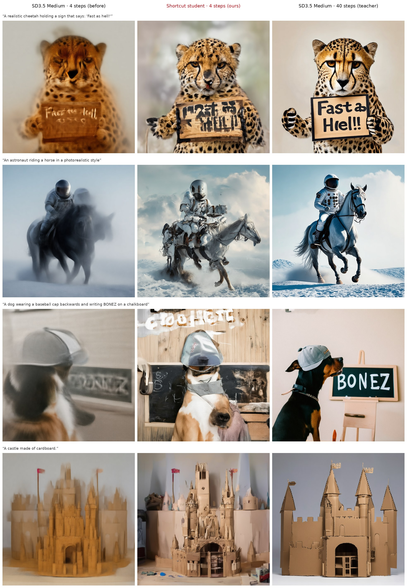
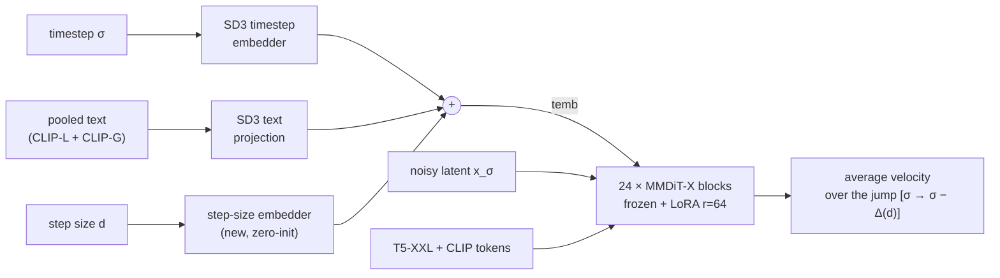
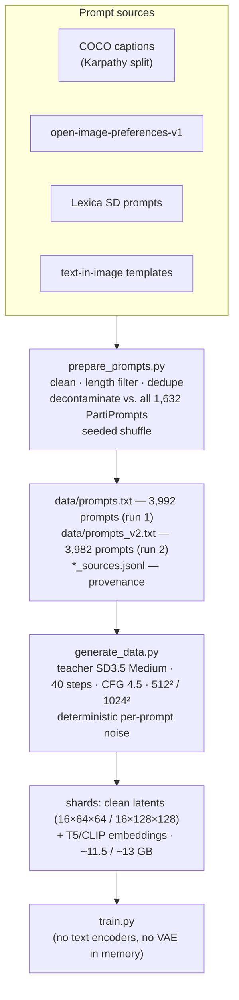
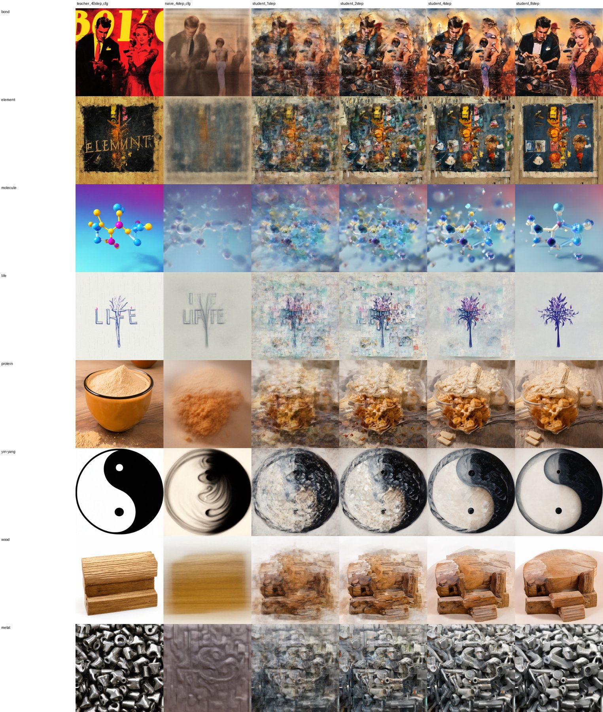
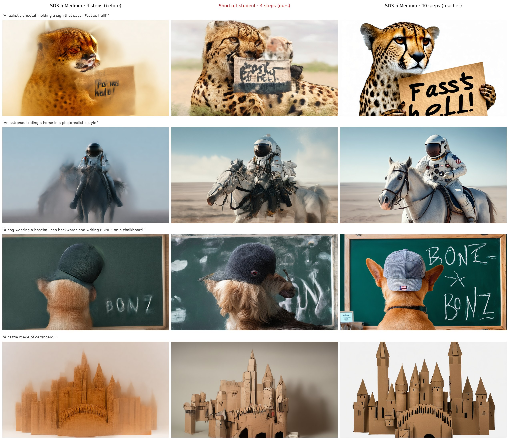
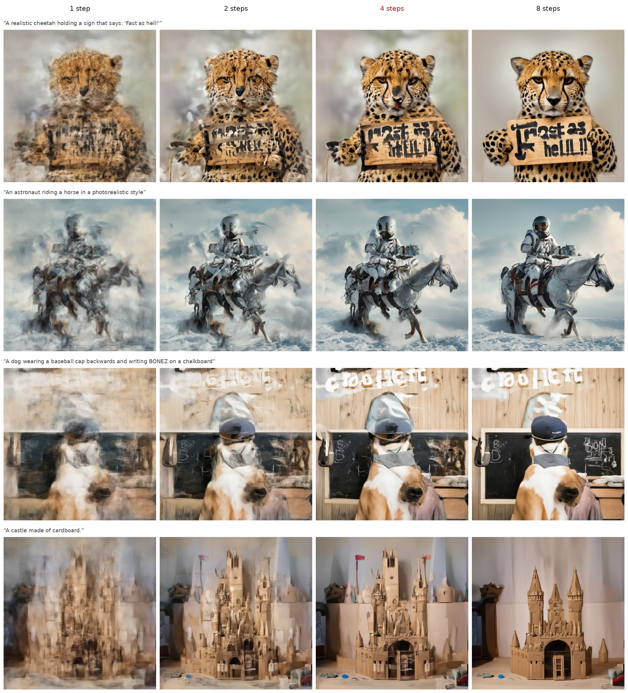
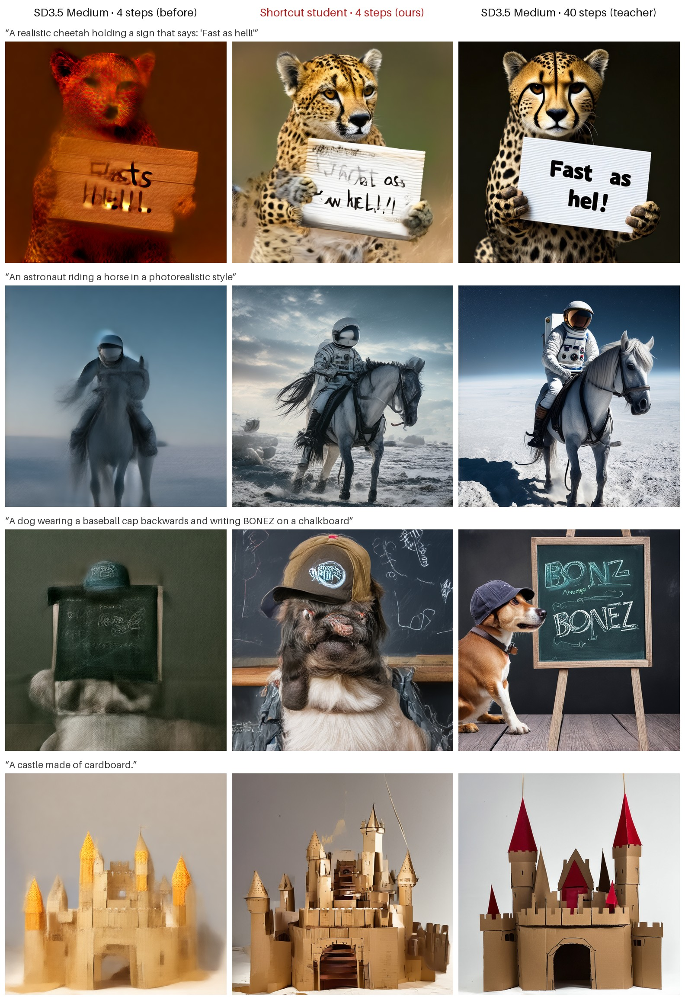
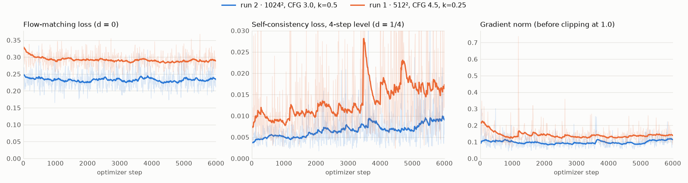
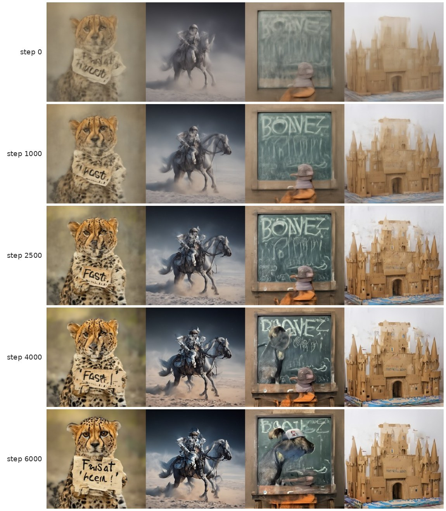

<div align="center">

# Shortcut Distillation of Stable Diffusion 3.5 Medium

**4-step text-to-image generation with SD3.5 Medium via shortcut-model self-consistency, trained as a LoRA adapter with an explicit step-size embedding**

[](https://www.python.org/)
[](https://pytorch.org/)
[](https://github.com/huggingface/diffusers)
[](https://huggingface.co/stabilityai/stable-diffusion-3.5-medium)
[](https://arxiv.org/abs/2410.12557)
[](LICENSE)

[Task](#1-task) · [Method](#2-method) · [Data](#3-data) · [Training](#4-training) · [Evaluation](#5-evaluation-protocol) · [Results](#6-results) · [Reproduce](#7-reproducing) · [Design decisions](#9-design-decisions-and-deviations) · [Citation](#13-citation)

</div>

---

## TL;DR

- **What.** A *shortcut model* (Frans et al., ICLR 2025) distilled from **Stable Diffusion 3.5 Medium**: the network is conditioned on the desired **step size `d`** and learns to jump along the probability-flow ODE, so one model samples in **1 / 2 / 4 / 8 steps**.
- **How.** Frozen 2.24B MMDiT-X + **LoRA r=64 (130M params, ~6%)** + a new **zero-initialised step-size embedder (2.8M)**. Loss = flow matching at `d=0` + self-consistency *"one 2d-jump = two d-jumps"*; classifier-free guidance is distilled into every `d>0`, so the student needs **one forward pass per step: 4 NFE vs. 80 NFE** for the teacher (40 steps × CFG).
- **Data.** **~4k images generated by the teacher itself** (40 steps, CFG 4.5): 3,992 at 512² (run 1) and 3,982 at 1024² (run 2), from a 4-source prompt corpus that is **decontaminated against all 1,632 PartiPrompts**.
- **Evaluation.** First 100 PartiPrompts + the 4 prompts from the task statement; teacher (40 steps) vs. naive teacher (4 steps) vs. student (1/2/4/8 steps) under identical noise; CLIP score, PickScore, CLIP similarity to the teacher, latency; at 1024² and at the task's example format 832×480.
- **Result (run 2, 1024²).** The 4-step student is **17× faster than the 40-step teacher** (0.34 vs. 5.88 s/img) and beats the naive 4-step teacher in **PickScore (20.72 vs. 20.07)** and **fidelity to the teacher (CLIP-I 0.770 vs. 0.701)** with half its NFE. It stays below the naive baseline in CLIP score (−0.4), and **text rendering is its weakest point** at 4 steps (mostly legible at 8). Details and caveats in [§6](#6-results).

<p align="center">
  
  <br><em>The four task prompts at 1024², same noise per row. Left: SD3.5 Medium with 4 steps (CFG 4.5, 8 NFE). Middle: shortcut student with 4 steps (4 NFE). Right: the teacher with 40 steps (80 NFE).</em>
</p>

> [!NOTE]
> **Status.** Complete: code, data pipeline, two full training runs on 1×H800 (512² pilot and 1024² main run) and their evaluation. Tested with CPU smoke tests and a toy correctness experiment ([§10](#10-verification)).

---

## Contents

1. [Task](#1-task)
2. [Method](#2-method)
3. [Data](#3-data)
4. [Training](#4-training)
5. [Evaluation protocol](#5-evaluation-protocol)
6. [Results](#6-results)
7. [Reproducing](#7-reproducing)
8. [Repository structure](#8-repository-structure)
9. [Design decisions and deviations](#9-design-decisions-and-deviations)
10. [Verification](#10-verification)
11. [Compute and cost](#11-compute-and-cost)
12. [Limitations and future work](#12-limitations-and-future-work)
13. [Citation](#13-citation)
14. [Acknowledgements and licenses](#14-acknowledgements-and-licenses)

---

## 1. Task

The task statement (a one-page PDF, not redistributed in this repository) reads, verbatim:

> **Shortcut Distillation**
>
> Реализовать Shortcut дистилляцию на моделе Stable Diffusion 3.5 Medium. Для того, чтоб сделать обучение быстрее рекомендуем обучить LoRA адаптер.
> Данные нужно сгенерировать (достаточно 3-5k картинок). Статья: https://arxiv.org/pdf/2410.12557
>
> Бенчмарк: PartiPrompts (не обязательно генерировать все 1600 примеров, достаточно первых 100)
> Ожидаемый результат - подобные генерации за 4 шага.
>
> *"A realistic cheetah holding a sign that says: 'Fast as hell!'"* · *"An astronaut riding a horse in a photorealistic style"* · *"A dog wearing a baseball cap backwards and writing BONEZ on a chalkboard"* · *"A castle made of cardboard."*

**Translation.** Implement shortcut distillation of Stable Diffusion 3.5 Medium; training a LoRA adapter is recommended to make training faster. The data must be generated (3–5k images are enough). Paper: arXiv:2410.12557. Benchmark: PartiPrompts (the first 100 of ~1600 prompts are enough). Expected result: generations like the four examples above, **in 4 steps**.

### Requirement → implementation

| # | Requirement (task statement) | Implementation | Where |
|---|---|---|---|
| R1 | Shortcut distillation, arXiv:2410.12557 | Shortcut objective: flow matching at `d=0` + self-consistency over binary step sizes; explicit conditioning on `d` | [`shortcut_sd35/shortcut.py`](shortcut_sd35/shortcut.py), [`scripts/train.py`](scripts/train.py) |
| R2 | Stable Diffusion 3.5 Medium | `stabilityai/stable-diffusion-3.5-medium`, base weights frozen | — |
| R3 | LoRA adapter | LoRA r=64 on all 24 MMDiT-X blocks (130.4M params) + step-size embedder (2.8M) | [`shortcut.py`](shortcut_sd35/shortcut.py) |
| R4 | Generated data, 3–5k images | **3,992** (run 1, 512²) and **3,982** (run 2, 1024²) teacher generations (latents + text embeddings) | [`scripts/generate_data.py`](scripts/generate_data.py) |
| R5 | PartiPrompts, first 100 | First 100 rows of the official PartiPrompts set (HF mirror `nateraw/parti-prompts`, 1,632 prompts) | [`scripts/evaluate.py`](scripts/evaluate.py) |
| R6 | Results like the examples, in 4 steps | Student sampled with 4 steps (4 NFE, no CFG); dedicated grid on the 4 task prompts | [`scripts/evaluate.py`](scripts/evaluate.py) |

---

## 2. Method

### 2.1 Flow matching in the SD3 convention

SD3 is a rectified-flow model. With data $x_0$, noise $\varepsilon \sim \mathcal N(0, I)$ and noise level $\sigma \in [0, 1]$ ($\sigma = 1$ is pure noise):

$$
x_\sigma = (1-\sigma)\,x_0 + \sigma\,\varepsilon, \qquad v_\theta(x_\sigma, \sigma) \approx \varepsilon - x_0, \qquad x_{\sigma'} = x_\sigma + (\sigma' - \sigma)\, v_\theta(x_\sigma, \sigma).
$$

The shortcut paper uses the opposite time direction ($t = 0$ is noise); all formulas below are rewritten in the SD3 convention.

### 2.2 Shortcut models

A shortcut model $s_\theta(x_\sigma, \sigma, d)$ predicts the **average velocity over a jump of size $d$** rather than the instantaneous velocity. At $d = 0$ it is the ordinary flow model. Larger jumps are learned by **self-consistency**: one jump of size $2d$ must equal two consecutive jumps of size $d$. Each training batch mixes two losses (paper, Eq. 5 / Alg. 1):

$$
\mathcal L(\theta) =
\underbrace{\bigl\lVert s_\theta(x_\sigma, \sigma, 0) - (\varepsilon - x_0) \bigr\rVert^2}_{\text{flow matching, fraction } 1-k}
\;+\;
\underbrace{\bigl\lVert s_\theta(x_\sigma, \sigma, 2d) - \operatorname{sg}\bigl[s_{\text{target}}\bigr] \bigr\rVert^2}_{\text{self-consistency, fraction } k}
$$

with the bootstrap target built from two half-jumps of the **EMA** model:

$$
x' = x_\sigma - \Delta_1\, s_{\bar\theta}(x_\sigma, \sigma_0, d), \qquad
s_{\text{target}} = \frac{\Delta_1\, s_{\bar\theta}(x_\sigma, \sigma_0, d) + \Delta_2\, s_{\bar\theta}(x', \sigma_1, d)}{\Delta_1 + \Delta_2},
\qquad \Delta_1 = \sigma_0 - \sigma_1,\; \Delta_2 = \sigma_1 - \sigma_2 .
$$

As in the paper, step sizes are powers of two on a grid of $M$ steps, start times are multiples of the step size ("discrete time sampling"), and the second half-jump is queried at the **next** time $\sigma_1$ (Eq. 5 of the paper writes $t$; Algorithm 1 and the official code use $t + d$).

### 2.3 Adapting shortcut models to a pretrained SD3.5

| Question | Solution | Precedent |
|---|---|---|
| Non-uniform time grid (SD3 uses `shift = 3`) | `d` lives in uniform time $u$, with $\sigma(u) = 3u / (1 + 2u)$. Half-jumps have unequal $\sigma$-lengths, so the target is the **$\Delta\sigma$-weighted** average above. On a uniform grid it reduces exactly to the paper's $(s_1 + s_2)/2$ | MAGI-1, SCFM |
| How to feed `d` into a pretrained model | New **step-size embedder** (sinusoidal → MLP) whose **last layer is zero-initialised**; its output is added to SD3's `temb` (timestep + pooled text), which drives the adaLN modulation of every block. At initialisation, student ≡ teacher | SAM 3D (App. C.4); DiT shortcut models |
| What is trained | LoRA (r=64, α=64) on image/text attention (incl. the extra `attn2` self-attention of the first 13 MMDiT-X blocks), MLPs and adaLN projections, plus the step-size embedder; everything else frozen | SD3 paper (DPO-LoRA), SCFM |
| Classifier-free guidance | CFG (4.5 in run 1, 3.0 in run 2) is applied **only at the base level** (half-jumps at $d=0$); through the recursion it is baked into all $d > 0$, so few-step sampling runs **without CFG** (1 NFE/step) | Official code, MAGI-1, SAM 3D |
| Base case of the recursion | Half-jumps at $d = 0$ are evaluated by the **frozen teacher** (same weights, adapter disabled); `--base_velocity ema` gives the paper's pure self-bootstrapped variant | [§9](#9-design-decisions-and-deviations) |



### 2.4 Sampling

For $n$ steps the sampler uses the shifted grid $\sigma_i = \sigma(1 - i/n)$ and $d = 1/n$:
$x \leftarrow x + (\sigma_{i+1} - \sigma_i)\, s_\theta(x, \sigma_i, d)$ — **one forward pass per step, no CFG**.
For $n \ge M$ the same model runs as the original flow model ($d = 0$, with CFG).

---

## 3. Data

### 3.1 Pipeline



### 3.2 Prompt corpus

The task statement fixes the *images* (generated, 3–5k) but not the *prompts*. The corpus below is built to (i) resemble the benchmark's style without overlapping it, (ii) cover the visual styles that SD3.5 users actually request, and (iii) explicitly cover **text rendering**, which two of the four task examples require and which is the first capability to degrade in few-step students.

| Source | HF id | Run 1: prompts (share) | Run 2: prompts (share) | Words (median) | License | Why it is included |
|---|---|---:|---:|---:|---|---|
| COCO captions, Karpathy split | [`yerevann/coco-karpathy`](https://huggingface.co/datasets/yerevann/coco-karpathy) | 1,598 (40.0%) | 1,400 (35.2%) | 10 | CC BY 4.0 (COCO annotations) | Short compositional scenes (objects, counts, relations) — closest in style to PartiPrompts; one random caption per image |
| open-image-preferences-v1 | [`data-is-better-together/open-image-preferences-v1-binarized`](https://huggingface.co/datasets/data-is-better-together/open-image-preferences-v1-binarized) | 1,400 (35.1%) | 1,200 (30.1%) | 26 | Apache-2.0 | Community-curated modern T2I prompts across many categories (photography, anime, digital art, …); only the `prompt` column is read |
| Lexica Stable Diffusion prompts | [`Gustavosta/Stable-Diffusion-Prompts`](https://huggingface.co/datasets/Gustavosta/Stable-Diffusion-Prompts) | 599 (15.0%) | 598 (15.0%) | 35–36 | unknown (per dataset card) | Breadth of artistic styles and artist references typical of SD prompting |
| Text-in-image templates | generated in [`prepare_prompts.py`](scripts/prepare_prompts.py) | 395 (9.9%) | **784 (19.7%)** | 11 | — | Typography: *"X holding a sign that says '…'"*, *"… writing … on a chalkboard"*, mugs, neon signs, book covers |
| **Total** | | **3,992** | **3,982** | 13.5 / 12 | | |

Run 1 uses the default mix ([`data/prompts.txt`](data/prompts.txt)). Run 2 doubles the share of text-rendering prompts, because two of the four task prompts require legible text: `prepare_prompts.py --frac_coco 0.35 --frac_oip 0.30 --frac_lexica 0.15` (the rest is filled with templates) → [`data/prompts_v2.txt`](data/prompts_v2.txt).

**Construction rules** ([`scripts/prepare_prompts.py`](scripts/prepare_prompts.py), seed 0, fully reproducible):

1. **Decontamination.** Every candidate is normalised (lower-case, alphanumerics only) and dropped if it matches **any of the 1,632 PartiPrompts** — not just the 100 used for evaluation.
2. **Length.** 3–60 words (T5 sees up to 256 tokens; CLIP truncates at 77).
3. **Deduplication** after normalisation; templates are re-drawn until the target size is reached.
4. **Provenance.** [`data/prompts_sources.jsonl`](data/prompts_sources.jsonl) and [`data/prompts_v2_sources.jsonl`](data/prompts_v2_sources.jsonl) record the source of every prompt.
5. **No content filtering by default.** An optional `--filter` flag drops prompts that match a blocklist (sexual content, gore, weapons, drugs, extremism, politics, frequent celebrity names).

**Verified properties of both corpora:** 0 PartiPrompts (of 1,632); 0 of the 4 task prompts; 0 near-duplicates of them (e.g. no "astronaut + horse" or "cardboard + castle" prompts). Two of the four task prompts are themselves PartiPrompts, so benchmark decontamination also covers them.

### 3.3 Teacher generation

| Setting | Value | Rationale |
|---|---|---|
| Teacher | SD3.5 Medium, bf16 | task requirement |
| Sampler | `FlowMatchEulerDiscreteScheduler`, shift 3.0, **40 steps** | model-card recommendation |
| Guidance | CFG **4.5**, unconditional branch = empty prompt `""` | model-card recommendation; same null embedding is used for CFG distillation |
| Resolution | **512 × 512** (run 1) · **1024 × 1024** (run 2) | pilot vs. SD3.5 Medium's native resolution, see [§9](#9-design-decisions-and-deviations) and [§11](#11-compute-and-cost) |
| Text encoders | CLIP-L + OpenCLIP bigG + T5-XXL, `max_sequence_length = 256` | SD3.5 pipeline default |
| Noise | per-prompt deterministic: `seed = 1_000_003 · s + i` | independent of batch size / number of workers |
| Stored per sample | clean **latent in model space** (after the pipeline's own normalisation), T5+CLIP token embeddings, pooled embedding — all fp16 | training needs neither the VAE nor the 4.7B-parameter T5 |
| Storage | 8 safetensors shards, ~11.5 GB (512²) / ~13 GB (1024²); written atomically (resumable) | — |
| Throughput (measured, 1×H800 PCIe) | **0.82 img/s** at 512² (batch 16) → ~81 min · **0.18 img/s** at 1024² (batch 8) → ~6.1 h | [§11](#11-compute-and-cost) |

<p align="center">
  
  <br><em>Samples of the generated training data (teacher, 40 steps, CFG 4.5, 512²) for COCO/Lexica prompts:
  "a portrait of a evil dog dancing techno-style, cyberpunk concept art…", "A white sink sitting next to a toilet.",
  "A brown bear sitting against a tree with some leaves around him."</em>
</p>

Why teacher generations and not real images: the task requires generated data, and a distilled student must reproduce the **teacher's** distribution. Training on real photographs would instead fine-tune towards a different distribution.

---

## 4. Training

| Hyperparameter | Run 1 (512², pilot) | Run 2 (1024², main) | Source / note |
|---|---|---|---|
| Base grid $M$ (`--base_steps`) | 32 → student step sizes $d \in \{1/16, 1/8, \mathbf{1/4}, 1/2, 1\}$ | same | paper uses 128; see [§9](#9-design-decisions-and-deviations) |
| CFG distilled into $d > 0$ (`--cfg_scale`) | 4.5 | **3.0** | teacher data is always CFG 4.5; see [§9](#9-design-decisions-and-deviations) |
| Self-consistency fraction $k$ | 0.25 | **0.5** | paper (0.25); SAM 3D |
| Level sampling | round-robin over all 5 levels, uniform start times on the level's grid | same | official code |
| EMA (bootstrap targets) | 0.999 | same | paper |
| Optimizer | AdamW, lr 1e-4 (100 warm-up steps, then constant), weight decay 0.1, grad-clip 1.0 | same | paper (weight decay "crucial for stability") |
| Prompt dropout in the FM branch | 0.1 (replaced by empty-prompt embedding) | same | keeps the unconditional branch alive |
| Batch × accumulation / steps | 8 × 1 / 6,000 | 4 × 2 / 6,000 | effective batch 8, ~12 epochs over ~4k samples |
| Precision | bf16 autocast; LoRA + embedder master weights, Adam and EMA in fp32; TF32 enabled | same | — |
| Trainable parameters | LoRA 130.4M + step-size embedder 2.8M (base 2.24B frozen) | same | counted on the real config |
| Throughput (measured, 1×H800 PCIe, no gradient checkpointing) | **0.74 s/step**, 37.1 GB peak | **2.96 s/step**, 58.4 GB peak | [§11](#11-compute-and-cost) |

**Logged metrics** (TensorBoard via [`scripts/tb_sidecar.py`](scripts/tb_sidecar.py)): `loss/total`, `loss/flow_matching_d0`, `self_consistency/{01,02,04,08,16}_steps`, `train/grad_norm`, `train/lr`, `perf/*`, validation grids every 250 steps (rows = 1/2/4/8 steps, columns = the 4 task prompts), teacher-generation progress, final evaluation tables.

---

## 5. Evaluation protocol

**Prompts.** The first 100 PartiPrompts (as required) plus the 4 prompts of the task statement (qualitative grid).

> [!IMPORTANT]
> The first 100 PartiPrompts are all in the *Basic* challenge, 45 of them in the *Abstract* category, with a median length of **2 words** (*"bond"*, *"element"*, *"insight"*, *"an owl"*, …). They are much easier than the task's showcase prompts, which require multi-object scenes and text rendering. We therefore report the 4 task prompts separately.

**Resolutions.** Each run is evaluated at its training resolution (512² / 1024²) and at **832×480**, the format of the task's example images. At 832×480 the teacher and the naive baseline are identical for both runs (same noise), so the two students are directly comparable there.

**Methods** — all with the **same initial noise per prompt**, so images are directly comparable:

| Method | Steps | CFG | NFE / image |
|---|---:|---|---:|
| Teacher (reference) | 40 | 4.5 | 80 |
| Naive teacher (the baseline to beat) | 4 | 4.5 | 8 |
| **Shortcut student** | 1 / 2 / **4** / 8 | distilled | 1 / 2 / **4** / 8 |

**Metrics.**

| Metric | Measures | Model |
|---|---|---|
| CLIP score ↑ | prompt alignment, $100 \cdot \max(\cos(\text{img}, \text{text}), 0)$ | `openai/clip-vit-large-patch14` |
| PickScore ↑ | human-preference proxy | `yuvalkirstain/PickScore_v1` |
| CLIP-I to teacher ↑ | fidelity to the 40-step teacher image from the same noise | CLIP-L image embeddings |
| Latency ↓ | transformer time per image (bf16, 1×H800 PCIe) | — |

---

## 6. Results

Two full runs with the same method and code. Run 1 was a cheap pilot to validate the pipeline end to end; run 2 is the main result.

| | Run 1 (pilot) | Run 2 (main) |
|---|---|---|
| Data and training resolution | 512² | **1024²** (SD3.5 Medium's native resolution) |
| Prompt corpus | `prompts.txt`, 3,992, 10% text prompts | `prompts_v2.txt`, 3,982, **20% text prompts** |
| Teacher data | 40 steps, CFG 4.5 | 40 steps, CFG 4.5 |
| CFG distilled into the student | 4.5 | **3.0** |
| Self-consistency fraction $k$ | 0.25 | **0.5** |
| Shortcut levels, steps, effective batch | all 5 levels, 6,000, 8 | same |
| Wall-clock on 1×H800 | ≈ 3 h | ≈ 11.4 h |

**What changed after the pilot, and why.** Run 1 produced over-detailed, collage-like images, and its 4-step CLIP score fell below the naive baseline. This is a typical symptom of distilled guidance that is too strong, so run 2 distils CFG 3.0. The data uses 1024², the model's native resolution, for more detail. The text-prompt share is doubled because two of the four task prompts require legible text. $k = 0.5$ gives the shortcut levels a larger share of each batch. All five step-size levels are kept, as in the paper.

### 6.1 Main results: PartiPrompts (first 100)

**Run 2 at 1024²** (main result):

| Method | Steps | NFE | CLIP score ↑ | PickScore ↑ | CLIP-I to teacher ↑ | Latency, s/img ↓ | Speed-up |
|---|---:|---:|---:|---:|---:|---:|---:|
| Teacher, CFG 4.5 | 40 | 80 | 23.06 | 21.04 | 1.000 | 5.88 | 1× |
| Naive teacher, CFG 4.5 | 4 | 8 | 21.12 | 20.07 | 0.701 | 0.564 | 10× |
| Shortcut student | 1 | 1 | 18.33 | 20.03 | 0.623 | 0.081 | 72× |
| Shortcut student | 2 | 2 | 20.25 | 20.48 | 0.717 | 0.164 | 36× |
| **Shortcut student** | **4** | **4** | **20.74** | **20.72** | **0.770** | **0.337** | **17×** |
| Shortcut student | 8 | 8 | 21.46 | 20.82 | 0.785 | 0.691 | 8.5× |

**Run 2 at 832×480** (the task's example format; the student was trained on square 1024² only):

| Method | Steps | NFE | CLIP score ↑ | PickScore ↑ | CLIP-I to teacher ↑ | Latency, s/img ↓ | Speed-up |
|---|---:|---:|---:|---:|---:|---:|---:|
| Teacher, CFG 4.5 | 40 | 80 | 22.98 | 20.91 | 1.000 | 2.09 | 1× |
| Naive teacher, CFG 4.5 | 4 | 8 | 21.99 | 20.14 | 0.749 | 0.199 | 10× |
| Shortcut student | 1 | 1 | 18.78 | 19.88 | 0.650 | 0.032 | 66× |
| Shortcut student | 2 | 2 | 20.86 | 20.40 | 0.752 | 0.062 | 34× |
| **Shortcut student** | **4** | **4** | **21.45** | **20.68** | **0.803** | **0.125** | **17×** |
| Shortcut student | 8 | 8 | 21.89 | 20.82 | 0.827 | 0.258 | 8.1× |

**4-step student vs. the naive 4-step teacher**, all runs and resolutions (Δ = student − naive at the same resolution and noise):

| Run | Resolution | Δ CLIP score | Δ PickScore | CLIP-I to teacher: student / naive | Latency: student / naive |
|---|---|---:|---:|---|---|
| Run 1 | 512² | −0.64 | **+0.60** | **0.769** / 0.712 | 0.086 / 0.137 s |
| Run 1 | 832×480 | −0.84 | **+0.56** | **0.795** / 0.749 | 0.126 / 0.201 s |
| Run 2 | 1024² | −0.37 | **+0.65** | **0.770** / 0.701 | 0.337 / 0.564 s |
| Run 2 | 832×480 | −0.54 | **+0.54** | **0.803** / 0.749 | 0.125 / 0.199 s |

<details>
<summary>Run 1 (512² pilot): full tables</summary>

**512²**

| Method | Steps | NFE | CLIP score ↑ | PickScore ↑ | CLIP-I to teacher ↑ | Latency, s/img ↓ |
|---|---:|---:|---:|---:|---:|---:|
| Teacher, CFG 4.5 | 40 | 80 | 23.29 | 21.00 | 1.000 | 1.435 |
| Naive teacher, CFG 4.5 | 4 | 8 | 22.31 | 20.21 | 0.712 | 0.137 |
| Shortcut student | 1 | 1 | 20.41 | 20.06 | 0.615 | 0.022 |
| Shortcut student | 2 | 2 | 21.73 | 20.50 | 0.725 | 0.042 |
| **Shortcut student** | **4** | **4** | **21.67** | **20.81** | **0.769** | **0.086** |
| Shortcut student | 8 | 8 | 22.37 | 20.92 | 0.793 | 0.177 |

**832×480**

| Method | Steps | NFE | CLIP score ↑ | PickScore ↑ | CLIP-I to teacher ↑ | Latency, s/img ↓ |
|---|---:|---:|---:|---:|---:|---:|
| Teacher, CFG 4.5 | 40 | 80 | 22.98 | 20.91 | 1.000 | 2.104 |
| Naive teacher, CFG 4.5 | 4 | 8 | 21.99 | 20.14 | 0.749 | 0.201 |
| Shortcut student | 1 | 1 | 19.52 | 19.88 | 0.634 | 0.032 |
| Shortcut student | 2 | 2 | 21.30 | 20.39 | 0.746 | 0.062 |
| **Shortcut student** | **4** | **4** | **21.15** | **20.70** | **0.795** | **0.126** |
| Shortcut student | 8 | 8 | 21.91 | 20.84 | 0.816 | 0.259 |

</details>

**Findings.**

1. **The student beats the naive 4-step teacher** in PickScore (+0.54 to +0.65) and in fidelity to the 40-step teacher (CLIP-I +0.05 to +0.07) in every run and at every resolution. It does so with **half the NFE**, because the student needs no CFG, so it is also 1.6–1.7× faster.
2. **Against the 40-step teacher**, the 4-step student is **17× faster** and trails it by 0.23 to 0.33 PickScore. With 8 steps the gap shrinks to 0.09 to 0.22.
3. **CLIP score is the weak metric, and it is a text-rendering problem.** The student scores 0.4 to 0.8 below the naive baseline. The first 100 PartiPrompts are mostly one- or two-word abstract prompts ([§5](#5-evaluation-protocol)). On these the teacher, and even the blurry naive baseline, often write the prompt word into the image (*"element"*, *"life"*; grid below), and CLIP rewards rendered text strongly. The student usually fails to write the word and produces a busy, collage-like scene instead. Lowering the distilled CFG from 4.5 to 3.0 narrowed the 4-step gap at 832×480 from −0.84 to −0.54, but did not close it.
4. **Run 2 vs. run 1 at 832×480** (same teacher, same noise): at 4 steps, CLIP score +0.30, CLIP-I +0.008, PickScore unchanged (20.68 vs. 20.70). At 1 and 2 steps run 2 has a lower CLIP score (−0.74 / −0.44), so the change mostly helps the 4- and 8-step regime that the task targets.
5. **Resolution and aspect-ratio transfer.** Run 2 was trained only on square 1024² images. At 832×480 it reaches the highest fidelity to the teacher of all configurations: 0.803 at 4 steps, 0.827 at 8.

<details>
<summary>First 8 PartiPrompts, run 2 at 1024²: teacher · naive 4 steps · student 1/2/4/8 steps</summary>

<p align="center">
  
  <br><em>Rows: "bond", "element", "molecule", "life", "protein", "yin-yang", "wood", "metal". Columns: teacher 40 steps, naive 4 steps, student 1/2/4/8 steps (same noise per row).</em>
</p>

</details>

### 6.2 Task prompts (qualitative)

Same noise per row; the 4 prompts are those of the task statement.

<p align="center">
  
  <br><em>Run 2, 832×480 (the format of the task's examples). Left: SD3.5 Medium with 4 steps (CFG 4.5). Middle: shortcut student with 4 steps. Right: teacher with 40 steps. The 1024² version is shown at the top of this README.</em>
</p>

<p align="center">
  
  <br><em>One model, different step budgets (run 2, 1024², same noise). The sign reads "Fast as hell!!" at 8 steps.</em>
</p>

**Honest assessment against the task's expectation ("similar generations in 4 steps").** At 4 steps the student reproduces the composition, materials and photographic style of all four prompts, and it is far sharper than the 4-step teacher, which is hazy and ghosted. It does not reach the teacher's 40-step quality:

- **Text is the weakest point.** Signs and chalkboards contain letter-like strokes but are legible only for some seeds at 4 steps. At 8 steps they are mostly legible.
- **Some fine structures merge** at 4 steps, for example the astronaut's suit and the horse's harness.
- **Many-part objects can be over-detailed**, for example the turrets of the cardboard castle.

<details>
<summary>Run 1 (512² pilot): same comparison</summary>

<p align="center">
  
  <br><em>Run 1, 512².</em>
</p>
<p align="center">
  
  <br><em>Run 1, 832×480.</em>
</p>

</details>

### 6.3 Baseline: the teacher with few steps

<p align="center">
  
  <br><em>Starting point of training (step 0 = the teacher, since the step-size embedder is zero-initialised).
  Rows: 1, 2, 4, 8 Euler steps without CFG; columns: the four task prompts.
  One step collapses to the conditional mean (cf. Fig. 2 of the paper); 4–8 steps are hazy and the text is unreadable.</em>
</p>

### 6.4 Training dynamics

<p align="center">
  
  <br><em>Thin lines: logged values (every 10 steps); thick lines: exponential moving average. Absolute loss values are not comparable across resolutions.</em>
</p>

- **Flow-matching loss is flat.** The $d=0$ head is initialised as the teacher and trained on the teacher's own samples, so it starts at its noise floor. Being flat means the LoRA does not damage the base model.
- **The self-consistency loss rises slowly at the bootstrapped levels.** The plot shows the 4-step level. The rise is larger for coarser jumps (1-step level in run 2: 0.008 → 0.029) and absent at the finest level $d = 1/16$, whose target comes directly from the frozen teacher (0.026 → 0.025). This is expected for bootstrapped targets: as the finer levels learn, the targets for the coarser levels move from a blurry conditional mean towards sharp images, so the targets are not stationary. The loss of run 2 is lower and rises more slowly.
- **The gradient norm is stable** at about 0.1, an order of magnitude below the clipping threshold, with no spikes after warm-up and no divergence in either run.

<p align="center">
  
  <br><em>Run 2, 4-step samples from the validation grid during training (fixed noise; validation noise differs from the evaluation noise above). Step 0 is the teacher with 4 Euler steps and no CFG. Over training the samples become sharper, gain contrast and acquire a sign with partly legible text.</em>
</p>

### 6.5 Sanity check: shortcut learning on a toy problem

[`tests/toy_bimodal.py`](tests/toy_bimodal.py) pretrains a tiny SD3-architecture flow model on bimodal data (every latent is all +1 or all −1) and then distils it with the real `train.py`. Comparison with the teacher's 32-step ODE solution from the same noise:

| | 1 step: on-mode / MSE | 2 steps: on-mode / MSE | 4 steps: on-mode / MSE |
|---|---|---|---|
| Teacher, naive Euler | 34% / 0.556 | 92% / 0.087 | 100% / 0.031 |
| **Shortcut student** | **86% / 0.246** | **98%** / 0.128 | 100% / 0.079 |

Naive one-step Euler collapses to the mean of the two modes; the shortcut student does not. This verifies the objective, not image quality on SD3.5.

---

## 7. Reproducing

### 7.1 Software stack

| Component | Version | Note |
|---|---|---|
| Python | 3.12 | numpy 2.5 requires ≥ 3.12 |
| PyTorch | **2.15.0 + cu132** | wheel ships CUDA 13.2.2, cuDNN 9.26, NCCL; needs a driver with CUDA ≥ 13.2 |
| PyTorch (fallback) | 2.14.1 + cu126 | for CUDA 12.x drivers (`TORCH_CU=cu126`); also passes all tests |
| CUDA toolkit / nvcc | **not required** | no custom kernels; attention via PyTorch SDPA (FlashAttention-2 / cuDNN on Hopper) |
| diffusers · transformers · peft · accelerate | 0.43.0 · 5.23.0 · 0.22.0 · 1.16.0 | exact pins in [`requirements.txt`](requirements.txt) |

### 7.2 Quick start (any Linux box with one ≥ 24 GB GPU)

```bash
pip install torch==2.15.0 --index-url https://download.pytorch.org/whl/cu132   # or 2.14.1/cu126
pip install -r requirements.txt
hf auth login                      # account that accepted the SD3.5 Medium license
bash run_all.sh                    # run 1 (512² pilot): data → training → evaluation
```

Run 2 (the main result) is the same pipeline with different settings:

```bash
RES=1024 PROMPTS=data/prompts_v2.txt RUN_NAME=shortcut_1024_v2 DATA=$ROOT/data/sd35m_1024_v2 \
BATCH=4 ACCUM=2 GEN_BS=8 TRAIN_ARGS="--cfg_scale 3.0 --bootstrap_fraction 0.5" \
EVAL_SIZES="1024x1024 832x480" bash run_all.sh
```

Outputs: `runs/<RUN_NAME>/final/student_ema` (LoRA + step-size embedder, 272 MB) and `eval/<RUN_NAME>/<W>x<H>/` (`metrics.md`, grids, images). All settings of `run_all.sh` are environment variables, documented at the top of the script.

`run_all.sh` uses all visible GPUs (data generation is sharded across GPUs, training runs with DDP) and picks per-GPU defaults ([`scripts/gpu_defaults.sh`](scripts/gpu_defaults.sh)): on ≥ 60 GB GPUs gradient checkpointing is off and the generation batch is 16.

### 7.3 Remote GPU box, step by step

```bash
export ROOT=/path/to/big/disk         # venv, HF cache, data, runs (≥ 60 GB free)
bash setup_env.sh install             # (no GPU needed) Python 3.12 venv + torch build matched to the host driver
source $ROOT/shortcut_env.sh
hf auth login                         # or put the token into $HF_HOME/token
bash setup_env.sh download            # (no GPU needed) SD3.5 Medium (diffusers folders only), metric models, PartiPrompts
bash setup_env.sh check               # driver / CUDA / sm_90 / bf16 TFLOPS / attention kernels
bash setup_env.sh bench               # ~5 min: 64 teacher images + 30 train steps → measured ETA and cost
mkdir -p logs && nohup bash run_all.sh > logs/run_all.log 2>&1 &   # prefix with the run-2 variables above for 1024²
```

Optional: `NETWORK_SETUP=/path/to/proxy.sh` is sourced before downloads; `HF_ENDPOINT` is honoured as usual.

### 7.4 Using a trained student

```python
import torch
from diffusers import StableDiffusion3Pipeline
from shortcut_sd35.shortcut import load_student, shortcut_sample

pipe = StableDiffusion3Pipeline.from_pretrained(
    "stabilityai/stable-diffusion-3.5-medium", torch_dtype=torch.bfloat16).to("cuda")
student, cfg = load_student("runs/shortcut_1024_v2/final/student_ema", pipe.transformer)

pe, _, pp, _ = pipe.encode_prompt("A castle made of cardboard.", None, None,
                                  do_classifier_free_guidance=False)
noise = torch.randn(1, 16, 128, 128, device="cuda")   # latent of a 1024×1024 image (H/8 × W/8)
with torch.no_grad(), torch.autocast("cuda", dtype=torch.bfloat16):
    latents = shortcut_sample(student, noise, pe, pp, num_steps=4, cfg=cfg)   # 4 NFE, no CFG
    latents = latents / pipe.vae.config.scaling_factor + pipe.vae.config.shift_factor
    image = pipe.vae.decode(latents.to(pipe.vae.dtype)).sample
pipe.image_processor.postprocess(image)[0].save("castle_4steps.png")
```

---

## 8. Repository structure

```
shortcut_sd35/
  shortcut.py            step-size embedder, ShortcutSD3 wrapper, time grid, self-consistency targets,
                         sampler, EMA, LoRA save/load
  data.py                lazy shard dataset (safetensors slicing), task showcase prompts
scripts/
  prepare_prompts.py     prompt corpus (4 sources, decontamination, provenance)
  generate_data.py       teacher generation → latents + text embeddings (GPU-sharded, resumable)
  train.py               shortcut distillation (accelerate / DDP)
  evaluate.py            PartiPrompts evaluation: metrics + grids
  tb_sidecar.py          mirrors run logs into TensorBoard
  check_env.py           GPU / CUDA / torch sanity check
  bench_report.py        full-run ETA and cost from a 5-minute benchmark
  gpu_defaults.sh        per-GPU defaults (batch, gradient checkpointing)
data/
  prompts.txt            the 3,992 training prompts of run 1
  prompts_v2.txt         the 3,982 training prompts of run 2 (20% text rendering)
  prompts*_sources.jsonl provenance of every prompt
assets/                  figures of this README
tests/
  test_smoke.py          CPU tests on a tiny random SD3 (MMDiT-X with dual attention)
  toy_bimodal.py         toy experiment: does the objective learn shortcuts?
setup_env.sh             install / download / check / bench on a GPU box
run_all.sh               full pipeline
```

---

## 9. Design decisions and deviations

Choices that the task statement does not fix, stated explicitly:

| Decision | Rationale | Alternative (one flag away) |
|---|---|---|
| **Resolution: 512² pilot, then 1024²** | The task does not specify a resolution (its examples are ≈ 830×480). 512² is the cheapest point inside SD3.5's supported range (0.25–2 MP), so it was used to validate the whole pipeline first. The main run uses 1024², the model's native resolution, at 4.6× the FLOPs. Both are also evaluated at 832×480 | `RES=…`; evaluation alone can run at any resolution (`EVAL_SIZES`) |
| **Distilled CFG 3.0 in run 2** (teacher data: CFG 4.5) | With CFG 4.5 baked into the shortcut levels, the run-1 student over-saturated and over-detailed, and lost CLIP score on short prompts ([§6](#6-results)) | `--cfg_scale` |
| **$k = 0.5$ in run 2** (paper: 0.25) | More of each batch goes to the shortcut levels that the task is about; the flow-matching head is already the teacher at initialisation | `--bootstrap_fraction` |
| **All five step-size levels kept** | The paper trains every level, and one model serves 1 to 8 steps ([§6.2](#62-task-prompts-qualitative)). Dropping the 1- and 2-step levels might help the 4-step metric, but the model would no longer be a full shortcut model | `--min_shortcut_steps 4` |
| **Start from the pretrained model** instead of training from scratch | The task asks for *distillation* of SD3.5 with a LoRA; SAM 3D and MAGI-1 fine-tune pretrained flow models with the shortcut objective in the same way | — |
| **Finest grid 1/32** (paper: 1/128) | SD3.5 already samples well in ~32 steps; fewer levels mean less bootstrap error accumulation | `--base_steps 64/128` |
| **Base case from the frozen teacher** (paper: the model's own $d=0$ head) | In distillation the teacher is the ground-truth ODE. It also avoids drift of the student's $d=0$ head and double guidance, because the flow-matching branch is trained on CFG-generated images. In the toy experiment it halved the 4-step error w.r.t. the teacher (0.079 vs. 0.162) | `--base_velocity ema` (exactly the paper) |
| **Prompt corpus** | Not specified by the task; see [§3.2](#32-prompt-corpus) | `prepare_prompts.py --frac_* / --filter` |

---

## 10. Verification

| Check | What it guarantees |
|---|---|
| `python tests/test_smoke.py` (CPU, tiny random SD3 with dual attention) | zero-init ⇒ output independent of `d`, `teacher_mode` ≡ base model; LoRA reaches `attn2` and adaLN; the 4-step grid is a subset of the 32-step grid; the target equals an explicit two-step Euler (and the paper's average on a uniform grid); CFG; EMA weight swapping; end-to-end `train.py` in fp32 and bf16 with resume; `load_student` + sampling; `evaluate.teacher_sample` ≡ the diffusers pipeline loop |
| `torchrun --nproc_per_node 2` (CPU / gloo) | DDP + LoRA + gradient checkpointing; logging and saving only on rank 0 |
| `python tests/toy_bimodal.py` | the objective actually learns shortcuts ([§6.5](#65-sanity-check-shortcut-learning-on-a-toy-problem)) |
| `setup_env.sh check` / `bench` on 1×H800 PCIe | stack (torch 2.15 + CUDA 13.2, sm_90), 508 TFLOPS bf16 matmul, flash/cuDNN SDPA; real throughput and memory |
| Both torch 2.15.0 and 2.14.1 | all smoke tests pass on the primary and the fallback stack |

---

## 11. Compute and cost

Exact transformer FLOPs per forward pass (`torch.utils.flop_counter`, real SD3.5 Medium config, 333 text tokens):

| Resolution | Megapixels | Image tokens | TFLOP / forward | Relative |
|---|---:|---:|---:|---:|
| **512 × 512** | 0.26 | 1,024 | **2.44** | 1.00× |
| 832 × 480 | 0.40 | 1,560 | 3.67 | 1.50× |
| 768 × 768 | 0.59 | 2,304 | 5.59 | 2.29× |
| 1024 × 1024 | 1.05 | 4,096 | 11.25 | 4.61× |

Measured on **1× NVIDIA H800 PCIe 80 GB** (508 TFLOPS bf16 matmul):

| Stage | Run 1 (512²) | Run 2 (1024²) |
|---|---|---|
| Teacher data (~4k images, 40 steps + CFG) | 0.82 img/s → ~81 min | 0.18 img/s → ~6.1 h |
| Training (6,000 steps, without validation) | 0.74 s/step, 37.1 GB → ~74 min | 2.96 s/step, 58.4 GB → ~4.9 h |
| Validation grids + evaluation at 2 resolutions | ~0.4 h | ~0.4 h |
| **Total** | **≈ 3 GPU-hours ≈ $4.5** | **≈ 11.4 GPU-hours ≈ $17** |

Costs at ≈ $1.50 per H800 GPU-hour. Both runs together: ≈ 14.5 GPU-hours ≈ $22. Inference latencies are in [§6.1](#61-main-results-partiprompts-first-100).

---

## 12. Limitations and future work

- **Benchmark difficulty.** The required first-100 PartiPrompts slice is dominated by one- and two-word prompts; a stratified Parti sample (all categories and challenges) would be more informative.
- **Text rendering** is the main gap to the teacher at 4 steps ([§6.2](#62-task-prompts-qualitative)) and the main cause of the CLIP-score gap ([§6.1](#61-main-results-partiprompts-first-100)). Doubling the text prompts and lowering the distilled CFG helped only partly. Next steps: an OCR metric, more text data, and a higher LoRA rank or full fine-tuning of the attention layers.
- **Training length.** 6,000 steps (~12 epochs) with a constant learning rate is a budget choice. The bootstrapped losses had not plateaued, and longer training, an LR decay and SCFM's fast/slow EMA are untested.
- **Single seed.** Each configuration was trained once. With 100 prompts, differences of a few hundredths in CLIP-I or PickScore between runs should not be over-interpreted.
- **No adversarial loss.** Many few-step distillations (ADD, LADD) add a GAN term; this repository deliberately implements the pure shortcut objective required by the task.

---

## 13. Citation

```bibtex
@inproceedings{frans2025shortcut,
  title     = {One Step Diffusion via Shortcut Models},
  author    = {Frans, Kevin and Hafner, Danijar and Levine, Sergey and Abbeel, Pieter},
  booktitle = {International Conference on Learning Representations (ICLR)},
  year      = {2025}
}

@inproceedings{esser2024sd3,
  title     = {Scaling Rectified Flow Transformers for High-Resolution Image Synthesis},
  author    = {Esser, Patrick and Kulal, Sumith and Blattmann, Andreas and others},
  booktitle = {International Conference on Machine Learning (ICML)},
  year      = {2024}
}

@misc{suchotin2026shortcutsd35,
  title  = {Shortcut Distillation of Stable Diffusion 3.5 Medium},
  author = {Suchotin},
  year   = {2026},
  url    = {https://github.com/Suchotin/shortcut_distillation_sd3.5}
}
```

Related work this implementation draws on:
[SAM 3D](https://arxiv.org/abs/2511.16624) (shortcut fine-tuning of a pretrained flow model, zero-init step-size embedder) ·
[MAGI-1](https://arxiv.org/abs/2505.13211) (shortcut distillation with CFG distillation, step sizes on a shifted grid) ·
[SCFM](https://arxiv.org/abs/2510.17858) (shortcutting pretrained Flux / SD3.5 with LoRA) ·
[PartiPrompts](https://arxiv.org/abs/2206.10789) ·
[LoRA](https://arxiv.org/abs/2106.09685) ·
[PickScore](https://arxiv.org/abs/2305.01569) ·
[CLIP](https://arxiv.org/abs/2103.00020).

## 14. Acknowledgements and licenses

- **Code:** MIT ([LICENSE](LICENSE)).
- **Teacher model and derived weights:** Stable Diffusion 3.5 Medium is released under the [Stability AI Community License](https://huggingface.co/stabilityai/stable-diffusion-3.5-medium); LoRA adapters trained with this code are derivatives and inherit its terms.
- **Data:** COCO captions (CC BY 4.0), open-image-preferences-v1 (Apache-2.0), Lexica SD prompts (license unknown per the dataset card), PartiPrompts (Apache-2.0). Training images are generated by the teacher and are not redistributed.
- Thanks to the authors of shortcut models for the clear paper and [official implementation](https://github.com/kvfrans/shortcut-models).
